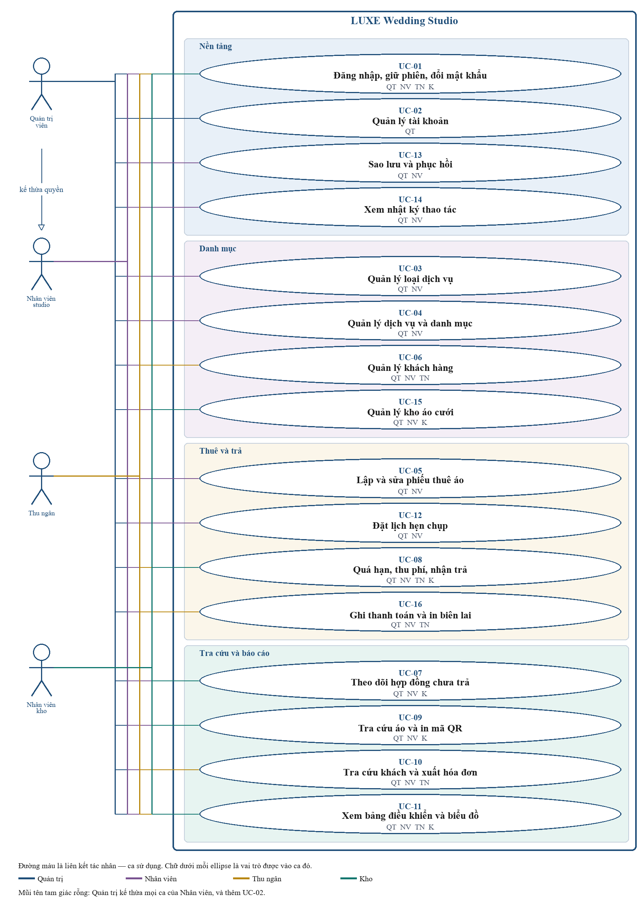

# BÁO CÁO TỔNG KẾT ĐỒ ÁN MÔN HỌC

**TRƯỜNG ĐẠI HỌC ĐÀ LẠT**  
**KHOA CÔNG NGHỆ THÔNG TIN**

## BÁO CÁO TỔNG KẾT ĐỒ ÁN MÔN HỌC  
## PHÁT TRIỂN ỨNG DỤNG DESKTOP

**Đề tài:** Xây dựng ứng dụng desktop LUXE Wedding Studio — quản lý studio ảnh cưới (Đề tài số 8, phân hệ F1–F8)

| Mục | Nội dung |
| --- | --- |
| Môn học | Phát triển Ứng dụng Desktop |
| Nhóm thực hiện | Nhóm 24 |
| Sinh viên thực hiện | Hoàng Long — MSSV 2212407 |
| Giảng viên hướng dẫn | [Học hàm, học vị và họ tên — điền trước khi nộp] |
| Năm học | 2026–2027 |
| Thời gian hoàn thành báo cáo | 26 tháng 11 năm 2026 |

Đà Lạt, tháng 11 năm 2026

> Trước khi nộp, thay dòng giảng viên hướng dẫn bằng đúng học hàm, học vị và họ tên giảng viên môn học. Hồ sơ mã nguồn và các tài liệu đã có trong kho chỉ ghi nhận một sinh viên; Chương IV được viết theo hồ sơ đó.

---

## LỜI CẢM ƠN

Trong quá trình thực hiện đồ án môn học Phát triển Ứng dụng Desktop, nhóm em xin bày tỏ lòng biết ơn đến giảng viên hướng dẫn. Thầy đã định hướng phạm vi đề tài, góp ý cách tách lớp giao diện, nghiệp vụ và dữ liệu, đồng thời yêu cầu phân biệt rõ chức năng đã chạy được với phần còn là hướng phát triển. Những góp ý đó giúp nhóm giữ báo cáo sát với sản phẩm đang có, tránh mô tả vượt quá những gì mã nguồn và bộ kiểm thử chứng minh được.

Nhóm em xin cảm ơn Ban lãnh đạo Khoa Công nghệ Thông tin, quý thầy cô bộ môn và Trường Đại học Đà Lạt đã tạo điều kiện về chương trình học, tài liệu và môi trường thực hành để nhóm hoàn thành ứng dụng desktop trong khuôn khổ một học phần.

Nhóm em cũng cảm ơn các bạn đã trao đổi về quy trình thuê áo cưới, cách tính tiền cọc và phí trễ hạn — những tình huống này được đưa vào quy tắc nghiệp vụ của phần mềm. Nhóm em xin kính chúc quý thầy cô và các bạn sức khỏe, hạnh phúc và thành công.

Trân trọng.

Nhóm 24

---

## NHẬN XÉT CỦA GIẢNG VIÊN HƯỚNG DẪN

*(Phần này để trống cho giảng viên ghi nhận xét, cho điểm và ký.)*

| Nội dung | |
| --- | --- |
| Nhận xét về phân tích nghiệp vụ | |
| Nhận xét về kiến trúc và chất lượng mã nguồn | |
| Nhận xét về mức độ hoàn thiện chức năng F1–F8 | |
| Nhận xét về báo cáo và thái độ làm việc | |
| Điểm | |
| Chữ ký giảng viên | |

---

## KHAI BÁO VỀ VIỆC SỬ DỤNG CÔNG CỤ TRÍ TUỆ NHÂN TẠO

Trong quá trình phát triển ứng dụng desktop LUXE Wedding Studio và hoàn thiện báo cáo này, nhóm có sử dụng công cụ trí tuệ nhân tạo tạo sinh với vai trò hỗ trợ. Việc khai báo nhằm bảo đảm minh bạch và trung thực học thuật.

**1. Hỗ trợ phát triển phần mềm**

Trợ lý lập trình trong môi trường Cursor được dùng để giải thích một số đoạn mã, gợi ý cách tổ chức thư mục và hỗ trợ gỡ lỗi ở lớp vỏ Electron, giao diện React và dịch vụ FastAPI. Mọi quyết định nghiệp vụ — giới hạn tối đa ba bộ áo, tiền cọc bằng 50% đơn giá, phí trễ hạn bằng đơn giá nhân 10% nhân số ngày trễ, quy tắc không trùng lịch thuê — do nhóm đặt ra và được kiểm tra lại trong mã nguồn (`backend/services/rules.py`, `backend/services/rental_service.py`) cùng các ca kiểm thử trong `tests/`.

Nhóm không coi đoạn mã do công cụ gợi ý là kết quả hoàn chỉnh. Các thay đổi được đọc lại, chạy trên máy phát triển và, với phần quy tắc tính tiền cùng một số điểm cuối API, được đối chiếu bằng pytest trước khi mô tả trong báo cáo.

**2. Hỗ trợ soạn thảo báo cáo**

Công cụ tạo sinh được dùng để sắp xếp bố cục theo cấu trúc báo cáo tổng kết của Khoa, chỉnh câu cho mạch lạc và thống nhất cách đánh số bảng, hình. Số liệu chức năng, tên bảng cơ sở dữ liệu, phiên bản thư viện và phạm vi kiểm thử trong báo cáo được lấy từ kho mã `luxe-wedding-studio` (README, `package.json`, `requirements.txt`, lược đồ SQLAlchemy và tệp kiểm thử), sau đó đọc lại bằng tay.

Các tài liệu tham khảo là tài liệu chính thức của công nghệ nhóm đã dùng hoặc tiêu chuẩn đã công bố. Đường dẫn được ghi kèm để có thể đối chiếu.

**3. Cam kết về trách nhiệm**

Công cụ trí tuệ nhân tạo chỉ hỗ trợ diễn đạt và gợi ý kỹ thuật. Ý tưởng đề tài, lựa chọn kiến trúc desktop (Electron + React + FastAPI + SQLite), quy tắc studio và kết luận về mức độ hoàn thiện là của sinh viên thực hiện. Nhóm chịu trách nhiệm về tính chính xác của báo cáo và của mã nguồn nộp kèm. Những chỗ mã nguồn chưa chứng minh được — đo hiệu năng, bộ cài không phụ thuộc Python trên máy đích, hóa đơn điện tử đúng nghĩa pháp lý — được ghi là hạn chế hoặc hướng phát triển, không ghi là kết quả đã đạt.

---

## MỤC LỤC

- Chương I. Tổng quan đề tài
  - 1.1. Bối cảnh và lý do chọn đề tài
  - 1.2. Mục tiêu và phạm vi
  - 1.3. Công nghệ lựa chọn
  - 1.4. Kế hoạch thực hiện
  - 1.5. Cấu trúc báo cáo
- Chương II. Phân tích và đặc tả hệ thống
  - 2.1. Tác nhân và danh mục ca sử dụng
  - 2.2. Đặc tả ca sử dụng cốt lõi
  - 2.2.5. Đặc tả các ca sử dụng còn lại
  - 2.3. Yêu cầu phi chức năng
  - 2.4. Kiến trúc phần mềm
  - 2.5. Thiết kế giao diện
  - 2.6. Thiết kế cơ sở dữ liệu
  - 2.7. Phân quyền
- Chương III. Triển khai, kiểm thử và kết quả
  - 3.1. Môi trường và cấu trúc mã nguồn
  - 3.2. Kết quả các màn hình chức năng
  - 3.3. Ma trận kiểm thử
  - 3.4. Mức đáp ứng mục tiêu
- Chương IV. Báo cáo thực hiện của từng thành viên
  - 4.1. Cách đọc chương này
  - 4.2. Hoàng Long — MSSV 2212407
- Chương V. Kết luận và hướng phát triển
  - 5.1. Kết quả chung
  - 5.2. Hạn chế
  - 5.3. Hướng phát triển
- Tài liệu tham khảo

## DANH MỤC HÌNH ẢNH

- Hình 2.1. Sơ đồ ca sử dụng theo miền nghiệp vụ của LUXE Wedding Studio
- Hình 2.2. Sơ đồ thực thể–liên kết mức logic
- Hình 3.1. Cây thư mục mã nguồn chính
- Hình 3.2. Màn hình đăng nhập
- Hình 3.3. Bảng điều khiển
- Hình 3.4. Loại dịch vụ và dịch vụ (F1, F2)
- Hình 3.5. Lập phiếu thuê áo cưới (F3)
- Hình 3.6. Danh mục dịch vụ theo loại (F4)
- Hình 3.7. Khách chưa trả và quá hạn (F5, F6)
- Hình 3.8. Tra cứu áo và mã QR (F7)
- Hình 3.9. Tra cứu khách và xuất hóa đơn (F8)
- Hình 3.10. Cài đặt, sao lưu và nhật ký

## DANH MỤC BẢNG BIỂU

- Bảng 1.1. Đối chiếu công nghệ lựa chọn
- Bảng 1.2. Kế hoạch thực hiện theo giai đoạn
- Bảng 1.3. Mục tiêu cụ thể và tiêu chí hoàn thành
- Bảng 2.1. Tác nhân của hệ thống
- Bảng 2.2. Danh mục ca sử dụng
- Bảng 2.3. Đặc tả UC-01 — Đăng nhập và phân quyền
- Bảng 2.4. Đặc tả UC-05 — Lập phiếu thuê áo cưới
- Bảng 2.5. Đặc tả UC-08 — Xử lý quá hạn và nhận trả
- Bảng 2.6. Đặc tả UC-10 — Tra cứu khách và xuất hóa đơn
- Bảng 2.7. Yêu cầu phi chức năng
- Bảng 2.8. Danh sách màn hình
- Bảng 2.9. Từ điển dữ liệu các bảng nghiệp vụ
- Bảng 2.10. Quy tắc toàn vẹn và quy ước định danh
- Bảng 2.11. Ma trận phân quyền theo thao tác ghi
- Bảng 2.12. Đặc tả UC-02 — Quản lý tài khoản
- Bảng 2.13. Đặc tả UC-03 — Quản lý loại dịch vụ
- Bảng 2.14. Đặc tả UC-04 — Quản lý dịch vụ và danh mục
- Bảng 2.15. Đặc tả UC-06 — Quản lý khách hàng
- Bảng 2.16. Đặc tả UC-07 — Theo dõi hợp đồng chưa trả
- Bảng 2.17. Đặc tả UC-09 — Tra cứu áo và in mã QR
- Bảng 2.18. Đặc tả UC-11 — Xem bảng điều khiển và biểu đồ
- Bảng 2.19. Đặc tả UC-12 — Đặt lịch hẹn chụp
- Bảng 2.20. Đặc tả UC-13 — Sao lưu và phục hồi
- Bảng 2.21. Đặc tả UC-14 — Xem nhật ký thao tác
- Bảng 2.22. Đặc tả UC-15 — Quản lý kho áo cưới
- Bảng 2.23. Đặc tả UC-16 — Ghi thanh toán và in biên lai
- Bảng 3.1. Ma trận kiểm thử chức năng và tình huống biên
- Bảng 3.2. Đối chiếu mục tiêu ban đầu và kết quả thực tế
- Bảng 4.1. Công việc Hoàng Long đã đảm nhận
- Bảng 5.1. Hạn chế còn tồn tại và hướng xử lý

## DANH MỤC TỪ VIẾT TẮT

| Viết tắt | Nghĩa |
| --- | --- |
| API | Application Programming Interface — giao diện lập trình ứng dụng |
| BLL | Business Logic Layer — lớp nghiệp vụ (trong báo cáo tương ứng thư mục `backend/services`) |
| CRUD | Create, Read, Update, Delete |
| CSDL | Cơ sở dữ liệu |
| DAL | Data Access Layer — lớp truy cập dữ liệu (trong báo cáo tương ứng SQLAlchemy models) |
| ERD | Entity–Relationship Diagram — sơ đồ thực thể liên kết |
| GUI | Graphical User Interface |
| IPC | Inter-Process Communication — trao đổi giữa tiến trình chính Electron và trang vẽ |
| JWT | JSON Web Token |
| NFR | Non-functional requirement — yêu cầu phi chức năng |
| ORM | Object–Relational Mapping |
| PDF | Portable Document Format |
| RBAC | Role-Based Access Control — phân quyền theo vai trò |
| REST | Representational State Transfer |
| UI | User Interface |

---

# CHƯƠNG I. TỔNG QUAN ĐỀ TÀI

## 1.1. Bối cảnh và lý do chọn đề tài

Studio ảnh cưới vận hành đồng thời nhiều loại dữ liệu: danh mục dịch vụ chụp, kho váy và áo dài, hợp đồng thuê có ngày nhận–ngày trả, tiền cọc, phí trễ hạn và hồ sơ khách. Khi các việc này nằm trên sổ hoặc tệp bảng tính rời, nhân viên dễ nhận thuê quá số bộ cho phép, xếp trùng một bộ áo vào hai khoảng ngày giao nhau, hoặc quên hợp đồng sắp đến hạn. Đề tài số 8 của học phần đặt bài toán đó thành tám phân hệ, từ danh mục loại dịch vụ đến tra cứu theo khách và xuất chứng từ.

Nhóm chọn triển khai bài toán dưới dạng ứng dụng desktop vì người dùng chính là nhân viên tại quầy studio. Ứng dụng cần cửa sổ riêng, chạy trên máy Windows của cơ sở, giữ dữ liệu ở tệp SQLite trên máy và vẫn có thể xuất CSV, Excel, PDF mà không phụ thuộc một trình duyệt đang mở tab khác. Phiên bản mô phỏng HTML trước đó được giữ trong thư mục `web-demo/` chỉ để đối chiếu; sản phẩm nộp của học phần này là ứng dụng Electron.

Tên sản phẩm là **LUXE Wedding Studio**, phiên bản 1.0.0. Phạm vi nghiệp vụ bám đề bài F1–F8 và được bổ sung các việc cần để một ứng dụng desktop dùng được hàng ngày: đăng nhập, bốn vai trò, khách hàng, lịch hẹn chụp, thanh toán, nhật ký thao tác và sao lưu tệp cơ sở dữ liệu. Các bổ sung này được nêu riêng ở mục phạm vi, để không bị gộp vào cam kết “đã đủ tám phân hệ đề bài”.

## 1.2. Mục tiêu và phạm vi

### 1.2.1. Mục tiêu tổng quát

Xây dựng ứng dụng desktop giúp studio ảnh cưới quản lý danh mục dịch vụ, kho áo cưới và hợp đồng thuê theo đúng các ràng buộc: mỗi khách đang thuê tối đa ba bộ, tiền cọc bằng 50% đơn giá từng bộ, không xếp hai hợp đồng trùng ngày trên cùng một bộ, bộ đang hỏng không cho thuê, phí trễ hạn bằng đơn giá nhân 10% nhân số ngày trễ, và hợp đồng còn không quá ba ngày đến hạn được đánh dấu sắp hết hạn.

### 1.2.2. Mục tiêu cụ thể

Bảng 1.3 gắn mỗi mục tiêu với cách kiểm tra. Cột “bằng chứng hiện có” chỉ những gì nhóm đối chiếu được trên mã nguồn tại thời điểm viết báo cáo.

**Bảng 1.3: Mục tiêu cụ thể và tiêu chí hoàn thành.**

| Mã | Mục tiêu | Tiêu chí hoàn thành | Bằng chứng hiện có |
| --- | --- | --- | --- |
| MT1 | Danh mục loại dịch vụ và dịch vụ (F1, F2) | Thêm, sửa, xóa; mô tả loại dịch vụ bắt buộc; đơn giá không âm; mã dịch vụ tự sinh; lọc theo loại, giá, trạng thái | Màn hình React và API tương ứng; pytest kiểm tra đăng nhập, tạo loại dịch vụ, từ chối mã trùng và mô tả rỗng |
| MT2 | Thuê áo cưới (F3) | Tối đa ba bộ đang thuê trên một khách; cọc 50%; chặn trùng lịch; chặn áo hỏng hoặc hết hàng | Quy tắc trong `rules.py` có kiểm thử đơn vị; API lập hợp đồng thực thi cùng quy tắc. Ca API hiện mới kiểm tiền cọc của một bộ sẵn sàng, chưa tạo hợp đồng vượt hạn mức |
| MT3 | Theo dõi chưa trả và quá hạn (F5, F6) | Sắp xếp danh sách chưa trả; tô cảnh báo khi còn tối đa ba ngày; tính phí; thu phí; xác nhận trả | Hàm tính phí và số ngày trễ có kiểm thử đơn vị; màn hình và API đã nối. Chưa có biên bản kiểm thử giao diện |
| MT4 | Tra cứu áo và khách (F7, F8) | Xem chi tiết, lịch sử thuê, mã QR; gộp dịch vụ đã dùng và các hợp đồng; xuất hóa đơn PDF nội bộ | API tra cứu và dịch vụ xuất PDF/Excel/CSV có trong mã. Chưa đo thời gian xuất trên bộ dữ liệu lớn |
| MT5 | Ứng dụng desktop cài được trên Windows ở mức phát triển | `npm run dev` mở cửa sổ Electron, tự chạy API nội bộ, đăng nhập được bằng tài khoản mẫu | README và `electron/main.cjs`. Gói NSIS là lệnh đã khai báo (`npm run dist:win`); báo cáo không ghi nhận đã phát hành bộ cài cho máy không có Python |

### 1.2.3. Phạm vi chức năng đã làm

Trong phạm vi đã cài đặt có tám phân hệ đề bài:

1. **F1 — Loại dịch vụ:** thêm, sửa, xóa, lọc theo trạng thái; mô tả không được để trống; mã loại không trùng.
2. **F2 — Dịch vụ:** thêm, sửa, xóa; đơn giá lớn hơn hoặc bằng 0; mã dịch vụ tự sinh theo dạng `DV` cộng số có ba chữ số; lọc và sắp xếp theo loại, giá, trạng thái.
3. **F3 — Thuê áo cưới:** lập hợp đồng, tối đa ba bộ đang thuê cho một khách, cọc 50% đơn giá từng bộ, không trùng khoảng ngày trên cùng một bộ, từ chối bộ hỏng hoặc hết hàng.
4. **F4 — Danh mục dịch vụ theo loại:** xem ảnh, giá và trạng thái còn hoặc ngừng.
5. **F5 — Khách chưa trả:** sắp xếp, đánh dấu hợp đồng còn không quá ba ngày, xuất CSV, Excel, PDF.
6. **F6 — Quá hạn:** phí bằng tổng (đơn giá từng bộ × 10% × số ngày trễ), ghi nhận thanh toán phí, xác nhận trả và cập nhật tình trạng áo.
7. **F7 — Tra cứu áo:** chi tiết, dòng thời gian thuê, tạo ảnh QR để dán theo bộ áo. Việc quét QR vẫn thực hiện trong ứng dụng đã đăng nhập.
8. **F8 — Tra cứu theo khách:** dịch vụ đã dùng, các hợp đồng thuê, tổng chi phí, xuất hóa đơn và bản “hóa đơn đỏ” theo mẫu nội bộ của studio.

Ngoài đề bài, ứng dụng còn có đăng nhập JWT, bốn vai trò (quản trị, nhân viên, thu ngân, kho), hồ sơ khách, lịch hẹn chụp, sổ thanh toán, bảng điều khiển, nhật ký audit, đổi mật khẩu, giao diện sáng/tối, tiếng Việt và tiếng Anh, sao lưu tệp SQLite lúc 02:00 và sao lưu thủ công. Phục hồi bản sao lưu chỉ dành cho quản trị.

### 1.2.4. Phạm vi không làm trong học phần này

Nhóm không triển khai kết nối máy in nhiệt tại quầy, không phát hành hóa đơn điện tử theo chuẩn cơ quan thuế, không đồng bộ nhiều chi nhánh theo thời gian thực và không xây dựng ứng dụng cho khách tự đặt lịch trên điện thoại. Tài liệu triển khai có nhắc khả năng chuyển URL sang PostgreSQL; tệp `backend/config/database.py` hiện gắn cố định vào SQLite. Vì vậy PostgreSQL là hướng kỹ thuật đã ghi chú, chưa phải cấu hình đang chạy.

Ứng dụng cũng không đo và công bố chỉ tiêu thời gian phản hồi. Các yêu cầu về tốc độ ở Chương II là mục tiêu thiết kế, chưa có số đo.

## 1.3. Công nghệ lựa chọn

Nhóm chọn ngăn xếp có thể chạy thành một cửa sổ desktop trên Windows, đồng thời giữ giao diện và nghiệp vụ tách nhau để kiểm thử quy tắc tính tiền mà không cần mở cửa sổ.

**Bảng 1.1: Đối chiếu công nghệ lựa chọn.**

| Hạng mục | Lựa chọn đang dùng | Vai trò trong sản phẩm | Phương án đã cân nhắc và lý do không chọn làm lõi |
| --- | --- | --- | --- |
| Vỏ ứng dụng desktop | Electron 28 | Tạo cửa sổ, khởi chạy tiến trình Python, nạp giao diện đã build | WinForms hoặc WPF đòi hỏi viết lại toàn bộ giao diện đã có hướng React; nhóm giữ Electron để tái sử dụng lớp giao diện |
| Ngôn ngữ giao diện | JavaScript, React 18, Vite 5 | Màn hình, định tuyến, trạng thái đăng nhập | TypeScript chưa được áp dụng; đây là đánh đổi về tốc độ làm đồ án, đổi lại ít kiểm tra kiểu lúc biên dịch |
| Thư viện giao diện | Ant Design 5, biểu đồ Recharts | Bảng, biểu mẫu, hộp thoại, biểu đồ doanh thu trên bảng điều khiển | Guna UI và MaterialDesign thuộc hệ WinForms/WPF, không gắn với React |
| Trạng thái phía máy khách | Redux Toolkit, React Router 6, i18next | Phiên đăng nhập, theme, ngôn ngữ, điều hướng | Để trạng thái chỉ trong từng trang sẽ khó giữ phiên khi đổi màn hình |
| Ngôn ngữ nghiệp vụ | Python 3.11, FastAPI 0.115, Uvicorn | API REST tại `127.0.0.1:8000` | Nhóm đã có kiểm thử pytest cho quy tắc nghiệp vụ; chuyển sang một tiến trình .NET sẽ bỏ phần kiểm thử này |
| ORM | SQLAlchemy 2.0 | Ánh xạ bảng, quan hệ, tạo lược đồ lúc khởi động | Viết SQL thuần cho mọi truy vấn làm phân tán quy tắc cọc và phí |
| CSDL | SQLite, bật khóa ngoại và journal WAL | Một tệp `luxe_studio.db`, phù hợp một máy quầy | SQL Server đòi hỏi dịch vụ cài riêng trên mỗi máy studio. PostgreSQL được ghi trong tài liệu triển khai nhưng chưa được nối trong mã |
| Xác thực | JWT (python-jose, HS256, hạn 12 giờ), mật khẩu bcrypt | Đăng nhập, gắn vai trò vào token | Lưu mật khẩu dạng thường hoặc chỉ giấu menu là chưa đủ; API cũng kiểm tra vai trò ở các thao tác ghi |
| Xuất chứng từ | ReportLab 4.2 (PDF), openpyxl (Excel), CSV UTF-8 có BOM | F5, F6, hóa đơn F8 | In trực tiếp qua hộp thoại máy in của hệ điều hành chưa làm |
| Mã QR | qrcode, Pillow | Ảnh QR gắn với mã áo, phục vụ tra cứu trong ứng dụng | QR công khai không cần đăng nhập chưa nằm trong phạm vi |
| Tác vụ nền | APScheduler | Sao lưu lúc 02:00 | Sao lưu chỉ bằng tay dễ quên file duy nhất của SQLite |
| Đóng gói | electron-builder, đích NSIS trên Windows | Khai báo trong `package.json` và `electron-builder.yml` | Bộ cài vẫn cần Python trên máy đích để chạy API; xem hạn chế ở Chương V |

Kiến trúc vận hành gồm ba tiến trình phối hợp: tiến trình chính của Electron, tiến trình vẽ React, và tiến trình API FastAPI. Đây không phải mẫu MVVM thuần trên một ngôn ngữ, cũng không phải mẫu ba lớp C# (GUI–BLL–DAL) trong một solution. Cách nhóm áp dụng tinh thần ba lớp là: React chỉ gọi HTTP, thư mục `backend/services` giữ quy tắc, thư mục `backend/models` và SQLite giữ dữ liệu. Quyết định này được giải thích thêm ở Mục 2.4.

## 1.4. Kế hoạch thực hiện

Học phần không lưu biên bản tiến độ theo từng tuần. Bảng 1.2 hệ thống lại các giai đoạn căn cứ trên sản phẩm đã có trong kho mã. Mốc thời gian là ước lượng để người đọc thấy thứ tự phụ thuộc, không phải nhật ký chấm công.

**Bảng 1.2: Kế hoạch thực hiện theo giai đoạn.**

| Giai đoạn | Việc chính | Kết quả dùng để chuyển giai đoạn | Trạng thái khi viết báo cáo |
| --- | --- | --- | --- |
| 1 | Chốt F1–F8, ràng buộc ba bộ, cọc 50%, phí 10%/ngày, cửa sổ sắp hết hạn ba ngày | Bảng quy tắc trong tài liệu hướng dẫn sử dụng khớp với hằng số trong `rules.py` | Đã chốt và đã cài trong mã |
| 2 | Lược đồ khách, áo, hợp đồng, dòng hợp đồng, lịch sử thuê, dịch vụ | Bảng tạo được khi ứng dụng khởi động | Đã có trong SQLAlchemy. Tệp `database/schema.sql` chưa theo kịp một số bảng phát sinh sau (thanh toán, lịch hẹn, cột bổ sung của khách và áo) |
| 3 | API danh mục, hợp đồng, tra cứu, xuất file | Đăng nhập được, tạo loại dịch vụ bị từ chối khi trùng mã hoặc thiếu mô tả | Đã có kiểm thử API cho các ca này |
| 4 | Giao diện React và vỏ Electron | `npm run dev` mở cửa sổ và đợi API khỏe | Đã chạy ở môi trường phát triển |
| 5 | Phân quyền bốn vai trò, sao lưu, nhật ký, lịch hẹn, song ngữ | Menu ẩn mục không thuộc vai trò; phục hồi bản sao lưu trả về lỗi nếu không phải quản trị | Đã cài. Một số API đọc vẫn chỉ yêu cầu đã đăng nhập (Mục 2.7) |
| 6 | Kiểm thử biên và đo hiệu năng | Ma trận Chương III có kết quả thực tế cho từng dòng | Mới có kiểm thử đơn vị và ba ca API. Các dòng còn lại trong ma trận là kịch bản cần chạy, chưa có biên bản |

## 1.5. Cấu trúc báo cáo

Chương II viết đặc tả mà mã nguồn đang bám: tác nhân, sơ đồ ca sử dụng, đặc tả đủ mười sáu ca, yêu cầu phi chức năng, kiến trúc, danh sách màn hình và từ điển dữ liệu. Chương III mô tả cách chạy, chỗ cần dán ảnh chụp màn hình, rồi đối chiếu kiểm thử với mục tiêu. Chương IV ghi phần việc của sinh viên có tên trong hồ sơ nhóm. Chương V tách kết quả đã chạy khỏi hạn chế và việc nên làm tiếp.

---

# CHƯƠNG II. PHÂN TÍCH VÀ ĐẶC TẢ HỆ THỐNG

## 2.1. Tác nhân và danh mục ca sử dụng

### 2.1.1. Tác nhân

Hệ thống có bốn tác nhân là người dùng đăng nhập. Không có tác nhân hệ thống bên ngoài gửi dữ liệu vào. Tác vụ sao lưu lúc 02:00 chạy trong cùng tiến trình API, không được mô hình hóa thành tác nhân riêng.

**Bảng 2.1: Tác nhân của hệ thống.**

| Tác nhân | Mục đích | Việc được làm | Việc không được làm |
| --- | --- | --- | --- |
| Quản trị viên (`admin`) | Cấu hình studio và xử lý sự cố dữ liệu | Toàn bộ thao tác ghi; quản lý tài khoản; phục hồi bản sao lưu | Không có hạn chế trong ma trận hiện tại |
| Nhân viên studio (`staff`) | Vận hành danh mục, hợp đồng, lịch hẹn | Ghi danh mục, khách, hợp đồng, lịch hẹn; được cộng thêm quyền thu ngân và kho vì các nhóm quyền đều bao gồm `admin` và, với hợp đồng, nhân viên nằm trong nhóm được phép | Không tạo tài khoản, không phục hồi cơ sở dữ liệu |
| Thu ngân (`cashier`) | Thu tiền | Xem các màn hình được cấp; ghi nhận thanh toán và thu phí trễ hạn | Không lập hợp đồng (`studio_writer` chỉ gồm quản trị và nhân viên), không sửa danh mục |
| Nhân viên kho (`warehouse`) | Giữ áo và nhận trả | Xem kho và hợp đồng; xác nhận trả áo | Không lập hợp đồng, không sửa đơn giá, không thu phí |

Tài khoản mẫu do chương trình tạo khi cơ sở dữ liệu trống: `admin` / `admin123`, `staff` / `staff123`, `cashier` / `cashier123`, `kho` / `kho123`. Đây là mật khẩu phục vụ chấm bài và trình diễn. Trước khi dùng ở studio thật, quản trị phải đổi mật khẩu và đổi biến `JWT_SECRET`.

### 2.1.2. Danh mục ca sử dụng

**Bảng 2.2: Danh mục ca sử dụng của LUXE Wedding Studio.**

| Mã | Tên ca sử dụng | Tác nhân chính | Phân hệ | Trạng thái cài đặt |
| --- | --- | --- | --- | --- |
| UC-01 | Đăng nhập, giữ phiên, đổi mật khẩu | Cả bốn vai trò | Nền | Đã có API và màn hình |
| UC-02 | Quản lý tài khoản | Quản trị | Nền | Đã có; menu chỉ hiện với quản trị |
| UC-03 | Quản lý loại dịch vụ | Nhân viên, quản trị | F1 | Đã có; có kiểm thử API một phần |
| UC-04 | Quản lý dịch vụ và xem danh mục | Nhân viên ghi; các vai trò được cấp quyền thì xem | F2, F4 | Đã có màn hình và API |
| UC-05 | Lập và sửa phiếu thuê áo | Nhân viên, quản trị | F3 | Đã có quy tắc trên API |
| UC-06 | Quản lý khách hàng | Nhân viên, quản trị | Bổ sung | Đã có |
| UC-07 | Theo dõi hợp đồng chưa trả | Người đã đăng nhập và được vào màn hình | F5 | Đã có; xuất CSV, Excel, PDF |
| UC-08 | Xử lý quá hạn, thu phí, nhận trả | Thu ngân thu phí; kho hoặc nhân viên nhận trả | F6 | Đã có trên API |
| UC-09 | Tra cứu áo và in QR | Người được vào màn hình tra cứu | F7 | QR tạo trong ứng dụng, không phải trang công khai |
| UC-10 | Tra cứu khách và xuất hóa đơn | Người được vào màn hình | F8 | Hóa đơn là mẫu PDF nội bộ |
| UC-11 | Xem bảng điều khiển | Người đã đăng nhập | Bổ sung | Đã có số liệu đếm và biểu đồ |
| UC-12 | Đặt lịch hẹn chụp | Nhân viên, quản trị | Bổ sung | Đã có; ngoài tám phân hệ đề bài |
| UC-13 | Sao lưu và phục hồi | Mọi vai trò có menu Cài đặt được sao lưu; chỉ quản trị phục hồi | Nền | Đã có sao lưu tệp; lịch 02:00 |
| UC-14 | Xem nhật ký thao tác | Quản trị, nhân viên trên menu; API hiện nhận mọi token hợp lệ | Nền | Ghi các thao tác thêm, sửa, xóa chính |
| UC-15 | Quản lý kho áo cưới | Nhân viên và quản trị ghi; kho xem | Bổ sung | Đã có size, màu, phụ kiện, trạng thái |
| UC-16 | Ghi thanh toán và in biên lai | Thu ngân, nhân viên, quản trị | Bổ sung | Sổ `payments`: cọc, thuê, phí, dịch vụ, hoàn cọc |

Sơ đồ ca sử dụng nhóm mười sáu ca thành bốn miền: nền tảng, danh mục, thuê và trả, tra cứu–báo cáo. Ranh giới hệ thống là cửa sổ desktop cùng API nội bộ. Tác nhân đứng ngoài ranh giới và chỉ đi qua màn hình đã đăng nhập.



**Hình 2.1: Sơ đồ ca sử dụng theo miền nghiệp vụ của LUXE Wedding Studio.**

Cách đọc Hình 2.1: đường màu là liên kết trực tiếp giữa tác nhân và ca sử dụng. Mũi tên tam giác rỗng từ Quản trị tới Nhân viên nghĩa là quản trị thực hiện được mọi ca của nhân viên và thêm UC-02. Thu ngân và nhân viên kho không nằm trên quan hệ kế thừa đó; hai vai trò chỉ nối tới các ca ghi dưới ellipse. Chữ tắt dưới ellipse là vai trò được mở ca trên giao diện (`roles.js`). UC-13 vẫn nối với nhân viên vì nhân viên sao lưu được; bước phục hồi bên trong ca chỉ mở cho quản trị. UC-15 và UC-16 được thêm vì kho áo và sổ thanh toán đã có trong mã nguồn, không gói hết vào UC-04 hay UC-08.

## 2.2. Đặc tả ca sử dụng cốt lõi

Mười sáu ca đều được đặc tả theo cùng một khung: tác nhân, tiền điều kiện, kích hoạt, luồng chính, luồng thay thế, hậu điều kiện. Bốn ca ngay dưới đây được viết trước vì chúng quyết định tính đúng của phần mềm: ai được vào hệ thống, hợp đồng thuê có tuân ràng buộc hay không, tiền phạt phát sinh ra sao, và chứng từ khách nhận được chứa những gì. Mười hai ca còn lại nằm ở Mục 2.2.5. Số bảng của mục đó bắt đầu từ 2.12 để không đánh lại Bảng 2.7–2.11 đã được trích ở các mục sau.

### 2.2.1. Đăng nhập và phân quyền

**Bảng 2.3: Đặc tả ca sử dụng UC-01 — Đăng nhập và phân quyền.**

| Thành phần | Nội dung |
| --- | --- |
| Tác nhân | Quản trị, nhân viên, thu ngân, nhân viên kho |
| Tiền điều kiện | API nội bộ đã lắng nghe; tài khoản tồn tại và đang hoạt động; mật khẩu được lưu dưới dạng băm bcrypt |
| Kích hoạt | Người dùng mở ứng dụng và gửi tên đăng nhập cùng mật khẩu |
| Luồng chính | Giao diện gọi `POST /api/auth/login`. Dịch vụ tìm tài khoản, kiểm tra còn hiệu lực, đối chiếu mật khẩu. Nếu khớp, hệ thống cấp JWT chứa tên đăng nhập, vai trò và thời điểm hết hạn (12 giờ). Giao diện lưu token, gọi thông tin người dùng hiện tại và chỉ dựng các mục menu thuộc vai trò đó |
| Luồng thay thế | Sai mật khẩu hoặc tài khoản khóa: HTTP 401, không cấp token. Token hết hạn hoặc bị sửa: các API sau đó trả 401, giao diện đưa về màn hình đăng nhập. Người dùng đã đăng nhập nhưng gọi thao tác ghi ngoài vai trò: HTTP 403 với thông báo không có quyền |
| Hậu điều kiện | Phiên hợp lệ trong hạn token. Menu và nút ghi trên giao diện phản ánh vai trò. Việc ẩn menu không thay thế kiểm tra trên API |

Điểm cần giữ khi đọc ca này: phân quyền ghi được đặt ở dependency của FastAPI (`require_admin`, `catalog_writer`, `studio_writer`, `cashier_writer`, `warehouse_writer`). Quản trị được cộng vào mọi nhóm quyền ghi. Thu ngân không nằm trong nhóm lập hợp đồng.

### 2.2.2. Lập phiếu thuê áo cưới

**Bảng 2.4: Đặc tả ca sử dụng UC-05 — Lập phiếu thuê áo cưới.**

| Thành phần | Nội dung |
| --- | --- |
| Tác nhân | Nhân viên studio (chính), quản trị |
| Tiền điều kiện | Đã đăng nhập với vai trò được phép ghi hợp đồng; khách hàng đã có mã; các bộ áo cần thuê đang ở trạng thái sẵn sàng |
| Kích hoạt | Người dùng chọn khách, ngày thuê, ngày trả dự kiến và danh sách bộ áo rồi lưu |
| Luồng chính | API kiểm tra có ít nhất một bộ và không chọn trùng bộ trong cùng hợp đồng. Ngày trả không được trước ngày thuê. Số bộ đang thuê của khách (trạng thái đang thuê hoặc quá hạn) cộng với số bộ mới không vượt quá 3. Từng bộ phải tồn tại, không ở trạng thái hỏng, không hết hàng, và không có hợp đồng khác giao khoảng ngày. Khoảng giao nhau tính cả ngày biên: ngày trả của hợp đồng cũ trùng ngày thuê của hợp đồng mới vẫn bị coi là trùng. Tiền cọc từng bộ bằng 50% đơn giá, làm tròn đến đồng. Hệ thống cấp mã hợp đồng `HD` kèm số, ghi dòng hợp đồng, chuyển trạng thái áo sang đang thuê, ghi lịch sử và, nếu có thu cọc, ghi một dòng thanh toán loại cọc |
| Luồng thay thế | Thiếu bộ, trùng bộ, ngày trả trước ngày thuê, vượt quá ba bộ, áo không tồn tại, áo hỏng, áo hết hàng hoặc trùng lịch: HTTP 400 hoặc 404, không tạo hợp đồng. Nếu ngày trả dự kiến đã nằm trong quá khứ tại thời điểm lập, hợp đồng được tạo với trạng thái quá hạn thay vì đang thuê |
| Hậu điều kiện | Có một hợp đồng và các dòng áo tương ứng. Tổng cọc bằng tổng 50% đơn giá các bộ, trừ khi người gọi gửi một số tiền cọc khác trong payload. Tồn kho áo không còn trạng thái sẵn sàng với các bộ vừa cho thuê |

Thứ tự xử lý là kiểm tra hết điều kiện rồi mới cấp mã và ghi. Cách này tránh mã hợp đồng mồ côi khi danh sách áo không hợp lệ.

### 2.2.3. Quá hạn, thu phí và nhận trả

**Bảng 2.5: Đặc tả ca sử dụng UC-08 — Xử lý quá hạn và nhận trả.**

| Thành phần | Nội dung |
| --- | --- |
| Tác nhân | Thu ngân hoặc nhân viên khi thu phí; nhân viên kho, nhân viên studio hoặc quản trị khi xác nhận trả |
| Tiền điều kiện | Hợp đồng đang ở trạng thái đang thuê hoặc quá hạn; người dùng có đúng nhóm quyền của thao tác |
| Kích hoạt | Người dùng mở danh sách quá hạn hoặc phiếu thuê, chọn thu phí hoặc nhận trả |
| Luồng chính | Khi danh sách được tải, dịch vụ rà các hợp đồng đang thuê mà ngày trả dự kiến đã qua và chuyển chúng sang quá hạn. Số ngày trễ bằng số ngày từ ngày trả dự kiến đến ngày xét, không âm. Phí bằng tổng theo từng bộ của (đơn giá bộ × 0,10 × số ngày trễ). Thu phí ghi nhận thanh toán qua nhóm quyền thu ngân. Nhận trả ghi ngày trả thực tế, chuyển hợp đồng sang đã trả, tính phí theo ngày trả, và cập nhật tình trạng áo nếu người dùng đánh dấu hỏng |
| Luồng thay thế | Hợp đồng không tồn tại: HTTP 404. Hợp đồng đã trả: không sửa và không nhận trả lần nữa. Người dùng kho gọi API thu phí, hoặc thu ngân gọi API lập hợp đồng: HTTP 403 |
| Hậu điều kiện | Trạng thái hợp đồng và áo khớp với thao tác vừa ghi. Lịch sử thuê có thêm dòng. Phí đã tính có thể truy lại từ công thức và ngày trả, không chỉ từ một số hiển thị trên giao diện |

Công thức phí có kiểm thử đơn vị: đơn giá 1.000.000 đồng, trễ 0 ngày thì phí 0; trễ 3 ngày thì phí 300.000 đồng cho một bộ. Phí của hợp đồng nhiều bộ là tổng phí từng bộ. Báo cáo chưa có ca kiểm thử API xác nhận tổng này trên hai bộ khác giá.

### 2.2.4. Tra cứu khách và xuất hóa đơn

**Bảng 2.6: Đặc tả ca sử dụng UC-10 — Tra cứu khách và xuất hóa đơn.**

| Thành phần | Nội dung |
| --- | --- |
| Tác nhân | Người dùng đã đăng nhập và được mở màn hình tra cứu khách (quản trị, nhân viên, thu ngân) |
| Tiền điều kiện | Mã khách tồn tại; các dịch vụ đã dùng và hợp đồng thuê đã được ghi nhận trước đó |
| Kích hoạt | Người dùng nhập mã hoặc thông tin khách, xem bảng tổng hợp, rồi chọn xuất hóa đơn hoặc hóa đơn đỏ |
| Luồng chính | API tra cứu trả về dịch vụ đã dùng, các hợp đồng và tổng chi phí. Xuất file dựng PDF khổ A4 bằng ReportLab, font chữ lấy từ font hệ thống có hỗ trợ tiếng Việt (Arial hoặc Tahoma trên Windows). Bản hóa đơn đỏ dùng cùng đường xuất với cờ phân biệt mẫu, vẫn là mẫu nội bộ của studio |
| Luồng thay thế | Không tìm thấy khách: thông báo trên giao diện, không tạo file. Máy không có font Unicode đã khai báo: PDF rơi về Helvetica, tiếng Việt có thể mất dấu. Người dùng chưa đăng nhập: API từ chối |
| Hậu điều kiện | File tải về máy người dùng. Cơ sở dữ liệu không đổi khi chỉ xuất. Nội dung file phản ánh dữ liệu tại thời điểm gọi API |

Ca này cố ý không gọi sản phẩm là hóa đơn điện tử. Mẫu PDF phục vụ in nội bộ và nộp bài. Kết nối chữ ký số, mã cơ quan thuế và truyền nhận hóa đơn nằm ngoài phạm vi.

### 2.2.5. Đặc tả các ca sử dụng còn lại

Các bảng dưới đây phủ UC-02, UC-03, UC-04, UC-06, UC-07, UC-09 và UC-11 đến UC-16. UC-01, UC-05, UC-08 và UC-10 đã có ở Mục 2.2.1–2.2.4. Quan hệ giữa các ca: khi lập phiếu có thu cọc, UC-05 ghi một dòng thanh toán loại cọc vào cùng sổ với UC-16. Khi thu phí trễ và số phí lớn hơn 0, UC-08 ghi một dòng loại phí trễ hạn vào sổ đó. Xuất PDF của UC-10 là bước tùy chọn cuối ca, không phải ca riêng.

**Bảng 2.12: Đặc tả ca sử dụng UC-02 — Quản lý tài khoản.**

| Thành phần | Nội dung |
| --- | --- |
| Tác nhân | Quản trị viên |
| Tiền điều kiện | Đã đăng nhập bằng vai trò `admin`. Menu Tài khoản chỉ được dựng với vai trò này |
| Kích hoạt | Quản trị mở màn hình tài khoản để xem danh sách, tạo mới hoặc sửa một tài khoản |
| Luồng chính | API liệt kê người dùng. Khi tạo, hệ thống từ chối tên đăng nhập đã có và từ chối vai trò ngoài bốn giá trị `admin`, `staff`, `cashier`, `warehouse`. Mật khẩu được băm bcrypt trước khi ghi. Khi sửa, quản trị đổi họ tên, vai trò, trạng thái hoạt động hoặc mật khẩu mới. Mỗi lần tạo hoặc sửa đều ghi nhật ký |
| Luồng thay thế | Người không phải quản trị gọi API: HTTP 403; giao diện không hiện menu. Không tìm thấy người dùng khi sửa: HTTP 404. Tên đăng nhập trùng: HTTP 400, không thêm dòng |
| Hậu điều kiện | Bảng `users` phản ánh tài khoản vừa ghi. Mật khẩu không nằm dạng chữ rõ. Tài khoản bị tắt `is_active` không đăng nhập được ở lần sau |

**Bảng 2.13: Đặc tả ca sử dụng UC-03 — Quản lý loại dịch vụ (F1).**

| Thành phần | Nội dung |
| --- | --- |
| Tác nhân | Nhân viên studio (chính), quản trị |
| Tiền điều kiện | Đã đăng nhập với quyền ghi danh mục (`catalog_writer`) |
| Kích hoạt | Người dùng thêm, sửa, xóa hoặc lọc loại dịch vụ |
| Luồng chính | Mô tả là bắt buộc. Mã để trống thì hệ thống cấp mã tiền tố `LDV`; mã nhập tay bị từ chối nếu đã tồn tại. Danh sách lọc theo từ khóa và theo trạng thái đang dùng hoặc ngừng. Xóa chỉ thực hiện khi loại không còn dịch vụ con. Thao tác ghi được đưa vào nhật ký |
| Luồng thay thế | Mô tả trống, mã trùng, hoặc xóa loại đang có dịch vụ: HTTP 400, dữ liệu giữ nguyên. Thu ngân hoặc kho gọi API ghi: HTTP 403. Không tìm thấy mã khi sửa hoặc xóa: HTTP 404 |
| Hậu điều kiện | Loại dịch vụ mới hoặc đã sửa xuất hiện trên F1 và là đầu vào của F2. Loại đã xóa không còn được chọn khi tạo dịch vụ |

**Bảng 2.14: Đặc tả ca sử dụng UC-04 — Quản lý dịch vụ và danh mục (F2, F4).**

| Thành phần | Nội dung |
| --- | --- |
| Tác nhân | Nhân viên studio và quản trị khi ghi. Mọi vai trò được mở menu Danh mục thì xem |
| Tiền điều kiện | Loại dịch vụ đã tồn tại nếu người dùng gán dịch vụ vào loại đó |
| Kích hoạt | Người dùng tạo hoặc sửa dịch vụ, rồi mở danh mục theo loại để xem ảnh, giá và tình trạng còn hoặc hết |
| Luồng chính | Đơn giá không âm. Mã để trống thì hệ thống cấp mã tiền tố `DV`. Danh sách dịch vụ lọc theo từ khóa, loại, trạng thái và sắp theo mã hoặc theo giá tăng hay giảm. Màn danh mục đọc cùng dữ liệu dịch vụ, trình bày theo loại để khách xem tại quầy |
| Luồng thay thế | Loại dịch vụ không tồn tại hoặc mã dịch vụ trùng: HTTP 400. Không tìm thấy dịch vụ: HTTP 404. Xóa dịch vụ đang được tham chiếu bởi lượt sử dụng: hệ thống gỡ các dòng sử dụng đó rồi xóa dịch vụ. Vai trò ngoài nhóm ghi danh mục: HTTP 403 |
| Hậu điều kiện | Dịch vụ có mã, đơn giá và loại hợp lệ. Danh mục F4 đọc cùng bản ghi, không giữ một bảng giá riêng |

**Bảng 2.15: Đặc tả ca sử dụng UC-06 — Quản lý khách hàng.**

| Thành phần | Nội dung |
| --- | --- |
| Tác nhân | Nhân viên studio và quản trị khi ghi. Thu ngân được mở màn hình để xem |
| Tiền điều kiện | Đã đăng nhập. Quyền ghi thuộc `studio_writer` |
| Kích hoạt | Người dùng thêm hoặc sửa hồ sơ khách trước khi lập phiếu, đặt lịch hoặc xuất hóa đơn |
| Luồng chính | Hệ thống lưu tên, điện thoại, địa chỉ, email, tên cô dâu, tên chú rể, ngày cưới và nguồn khách. Mã để trống thì cấp mã tiền tố `KH`. Danh sách lọc theo từ khóa, nguồn khách và tháng cưới |
| Luồng thay thế | Không tìm thấy mã: HTTP 404. Xóa khách đã có hợp đồng thuê: HTTP 400. Xóa khách chưa có hợp đồng: hệ thống xóa các lượt sử dụng dịch vụ của khách rồi xóa hồ sơ. Thu ngân gọi API ghi: HTTP 403 |
| Hậu điều kiện | Mã khách dùng được cho UC-05, UC-12 và UC-10. Khách đã có hợp đồng không biến mất khỏi sổ thuê |

**Bảng 2.16: Đặc tả ca sử dụng UC-07 — Theo dõi hợp đồng chưa trả (F5).**

| Thành phần | Nội dung |
| --- | --- |
| Tác nhân | Quản trị, nhân viên, nhân viên kho trên menu. Thu ngân không có mục menu này |
| Tiền điều kiện | Đã có hợp đồng ở trạng thái đang thuê hoặc quá hạn |
| Kích hoạt | Người dùng mở báo cáo chưa trả, sắp xếp danh sách, hoặc xuất file |
| Luồng chính | Khi tải danh sách, dịch vụ rà hợp đồng đang thuê mà đã qua ngày trả dự kiến và chuyển chúng sang quá hạn. Hợp đồng đang thuê còn từ 0 đến 3 ngày được đánh dấu sắp hết hạn. Người dùng xuất CSV, Excel hoặc PDF. Nếu chọn nhắc hạn, hệ thống gửi email hoặc SMS cho các hợp đồng sắp hết hạn và quá hạn, với kênh đã được cấu hình |
| Luồng thay thế | Chưa cấu hình SMTP hoặc webhook SMS: lời nhắc trả về lỗi kênh, danh sách trên màn hình không đổi. Chưa đăng nhập: API từ chối. Việc xuất file chỉ đọc, không ghi thêm hợp đồng |
| Hậu điều kiện | File xuất nằm trên máy người dùng. Trạng thái quá hạn đã được cập nhật nếu có hợp đồng tới hạn trong lần tải. Nhắc hạn không đổi số tiền hợp đồng |

**Bảng 2.17: Đặc tả ca sử dụng UC-09 — Tra cứu áo và in mã QR (F7).**

| Thành phần | Nội dung |
| --- | --- |
| Tác nhân | Quản trị, nhân viên, nhân viên kho |
| Tiền điều kiện | Bộ áo đã có trong kho |
| Kích hoạt | Người dùng nhập mã, tên, loại, size, màu hoặc phụ kiện, rồi xem lịch sử thuê và in QR |
| Luồng chính | API trả về bộ áo khớp từ khóa cùng các hợp đồng đã gắn với bộ đó. Mã QR mang chuỗi `LUXE|DRESS|{mã áo}` và được vẽ trong ứng dụng. Cùng chuỗi này được ô quét ở màn quá hạn dùng để mở đúng hợp đồng, nên UC-09 cung cấp mã mà UC-08 đọc |
| Luồng thay thế | Không có bộ áo khớp: giao diện báo không tìm thấy, không tạo QR. Mã không tồn tại khi xin QR: HTTP 404 |
| Hậu điều kiện | Dữ liệu kho không đổi khi chỉ tra cứu hoặc in QR. Mã in ra đọc lại được thành đúng bộ áo |

**Bảng 2.18: Đặc tả ca sử dụng UC-11 — Xem bảng điều khiển và biểu đồ.**

| Thành phần | Nội dung |
| --- | --- |
| Tác nhân | Cả bốn vai trò |
| Tiền điều kiện | Đã đăng nhập. Số liệu lấy từ dịch vụ, kho áo, hợp đồng và thanh toán hiện có |
| Kích hoạt | Người dùng mở trang tổng quan hoặc trang biểu đồ |
| Luồng chính | Trang tổng quan đếm dịch vụ, áo, số áo sẵn sàng, hợp đồng chưa trả và quá hạn, kèm doanh thu dịch vụ và doanh thu thuê. Trang biểu đồ vẽ doanh thu theo tháng trong năm, top dịch vụ và tỷ lệ kho (đang thuê, sẵn sàng, hỏng, hết hàng) |
| Luồng thay thế | Chưa đăng nhập: API trả 401, giao diện về màn hình đăng nhập. Kho dữ liệu trống: các số đếm bằng 0, biểu đồ không phát sinh giao dịch giả |
| Hậu điều kiện | Không có bản ghi mới. Số trên màn hình là kết quả đọc tại thời điểm gọi API |

**Bảng 2.19: Đặc tả ca sử dụng UC-12 — Đặt lịch hẹn chụp.**

| Thành phần | Nội dung |
| --- | --- |
| Tác nhân | Nhân viên studio (chính), quản trị |
| Tiền điều kiện | Khách hàng đã có mã. Nếu chọn dịch vụ thì mã dịch vụ phải tồn tại |
| Kích hoạt | Người dùng chọn khách, khung giờ, nhiếp ảnh gia, phòng và lưu lịch |
| Luồng chính | Giờ kết thúc phải sau giờ bắt đầu. Nếu có tên nhiếp ảnh hoặc tên phòng, hệ thống từ chối lịch khác còn hiệu lực (khác trạng thái hủy) bị trùng người đó hoặc trùng phòng trong cùng khoảng giờ. Mã lịch cấp theo tiền tố `LH`. Danh sách lọc theo khoảng ngày |
| Luồng thay thế | Không có khách hoặc không có dịch vụ đã chọn: HTTP 404. Giờ kết thúc không sau giờ bắt đầu, hoặc trùng khung: HTTP 400, không tạo lịch. Thu ngân hoặc kho gọi API ghi: HTTP 403 |
| Hậu điều kiện | Lịch mới xuất hiện trên màn lịch hẹn. Hai lịch hiệu lực không cùng nhiếp ảnh hoặc cùng phòng trong một khoảng giờ giao nhau |

**Bảng 2.20: Đặc tả ca sử dụng UC-13 — Sao lưu và phục hồi.**

| Thành phần | Nội dung |
| --- | --- |
| Tác nhân | Quản trị và nhân viên khi sao lưu. Chỉ quản trị khi phục hồi |
| Tiền điều kiện | Tệp SQLite đang dùng đã tồn tại nếu muốn sao lưu. Bản cần phục hồi nằm trong thư mục backup |
| Kích hoạt | Người dùng bấm sao lưu trên màn Cài đặt, hoặc tiến trình API tới 02:00 thì tự sao lưu. Quản trị chọn một bản và phục hồi |
| Luồng chính | Sao lưu chép tệp cơ sở dữ liệu vào thư mục backup, kèm mốc thời gian trong tên file. Nếu biến `LUXE_CLOUD_SYNC_DIR` trỏ tới một thư mục, bản sao được chép thêm vào đó. Phục hồi ghi đè tệp đang dùng bằng bản đã chọn và chỉ đi qua `require_admin` |
| Luồng thay thế | Chưa có file cơ sở dữ liệu: sao lưu trả về không thành công. Thiếu tên bản khi phục hồi: HTTP 400. Nhân viên, thu ngân hoặc kho gọi phục hồi: HTTP 403. Thu ngân và kho không có menu Cài đặt |
| Hậu điều kiện | Đĩa có thêm một file sao lưu, hoặc tệp đang dùng trở về nội dung của bản đã chọn. Phục hồi là thao tác ghi đè, cần làm khi đã hiểu bản được chọn |

**Bảng 2.21: Đặc tả ca sử dụng UC-14 — Xem nhật ký thao tác.**

| Thành phần | Nội dung |
| --- | --- |
| Tác nhân | Quản trị và nhân viên trên menu. API liệt kê nhật ký hiện chỉ yêu cầu đã đăng nhập |
| Tiền điều kiện | Các ca ghi (tạo, sửa, xóa, đăng nhập, nhận trả, thu tiền) đã gọi hàm ghi nhật ký |
| Kích hoạt | Người dùng mở màn nhật ký |
| Luồng chính | API trả về các dòng mới nhất, mặc định tối đa 200, gồm tên đăng nhập, hành động, thực thể, mã thực thể, chi tiết và thời điểm |
| Luồng thay thế | Chưa đăng nhập: HTTP 401. Menu không hiện với thu ngân và kho; một token của hai vai trò đó vẫn gọi được đường đọc nếu bỏ qua giao diện. Điểm này trùng với nhận xét ở Bảng 2.11 |
| Hậu điều kiện | Nhật ký không bị xóa khi xem. Dòng mới phát sinh ở các ca ghi sau thời điểm xem |

**Bảng 2.22: Đặc tả ca sử dụng UC-15 — Quản lý kho áo cưới.**

| Thành phần | Nội dung |
| --- | --- |
| Tác nhân | Nhân viên studio và quản trị khi ghi. Nhân viên kho được mở màn hình để xem |
| Tiền điều kiện | Đã đăng nhập. Quyền ghi thuộc `catalog_writer` |
| Kích hoạt | Người dùng thêm bộ áo, sửa đơn giá, size, màu, phụ kiện, ảnh hoặc trạng thái |
| Luồng chính | Đơn giá không âm. Mã để trống thì cấp mã tiền tố `AC`; mã nhập tay bị từ chối nếu đã tồn tại. Trạng thái dùng trong hệ thống gồm sẵn sàng, đang thuê, hỏng hóc và hết hàng. Danh sách lọc theo từ khóa, trạng thái, loại, size và màu. Bộ đang nằm trong hợp đồng chưa trả thì không xóa được |
| Luồng thay thế | Đơn giá âm: bị từ chối ở tầng kiểm tra dữ liệu vào. Xóa bộ đang thuê: HTTP 400. Không tìm thấy mã: HTTP 404. Kho hoặc thu ngân gọi API ghi: HTTP 403 |
| Hậu điều kiện | Bộ áo sẵn sàng, không hỏng và không hết hàng mới được UC-05 chọn. Bộ vừa cho thuê chuyển sang đang thuê trong chính UC-05, không phải trong màn kho |

**Bảng 2.23: Đặc tả ca sử dụng UC-16 — Ghi thanh toán và in biên lai.**

| Thành phần | Nội dung |
| --- | --- |
| Tác nhân | Thu ngân (chính), nhân viên studio, quản trị |
| Tiền điều kiện | Khách đã có mã. Nếu gắn hợp đồng hoặc dịch vụ thì mã đó phải tồn tại. Quyền ghi thuộc `cashier_writer` |
| Kích hoạt | Người dùng nhập một khoản thu trên phiếu thuê hoặc trên hồ sơ khách, rồi in biên lai |
| Luồng chính | Số tiền phải lớn hơn 0. Loại giao dịch thuộc một trong năm giá trị: cọc, tiền thuê, phí trễ hạn, dịch vụ, hoàn cọc. Phương thức là tiền mặt hoặc chuyển khoản. Hệ thống cấp mã giao dịch tiền tố `GD` và mã biên lai tiền tố `BL`, tính số còn lại của hợp đồng nếu khoản gắn với hợp đồng, rồi ghi nhật ký. Biên lai PDF xuất theo mã giao dịch hoặc mã biên lai |
| Luồng thay thế | Loại hoặc phương thức lạ, hoặc số tiền không dương: HTTP 400. Không có khách, hợp đồng hoặc dịch vụ đã chỉ định: HTTP 404. Nhân viên kho gọi API ghi: HTTP 403. In biên lai không thấy mã: HTTP 404 |
| Hậu điều kiện | Sổ `payments` có thêm một dòng. Số đã thu và số còn lại trên phiếu đọc lại từ sổ này. In biên lai không sửa số tiền |

## 2.3. Yêu cầu phi chức năng

**Bảng 2.7: Yêu cầu phi chức năng.**

| Nhóm | Yêu cầu | Cách kiểm tra | Mức đã đạt |
| --- | --- | --- | --- |
| Hiệu năng giao diện | Cửa sổ làm việc ở độ phân giải tối thiểu 1100×720; thao tác lọc danh mục trên dữ liệu mẫu không cần tải lại cả ứng dụng | Quan sát khi chạy `npm run dev`. Chưa có phép đo thời gian | Thiết kế đã gắn `minWidth` và `minHeight`. Chưa công bố số millisecond |
| Khả năng phản hồi API nội bộ | Các truy vấn danh sách trên dữ liệu mẫu trả về trong thời gian đủ để thao tác quầy | Đo bằng công cụ gọi API trên bộ dữ liệu cố định, ghi phân vị 50 và 95 | Chưa đo. Không ghi một ngưỡng như thể đã đạt |
| Bảo mật mật khẩu | Mật khẩu không lưuplaintext; đăng nhập sai không cấp phiên | Đọc cột `password_hash`; pytest `test_login_and_f1_crud` kỳ vọng sai mật khẩu trả 401 | Đã làm với bcrypt. Mật khẩu mẫu và khóa ký JWT mặc định trong mã là điểm phải đổi khi ra khỏi máy chấm bài |
| Phân quyền | Thao tác ghi danh mục, hợp đồng, thu tiền, nhận trả và phục hồi bản sao lưu bị từ chối khi sai vai trò | Gọi API bằng token của từng vai trò | Đã cài trên các đường ghi chính. Một số đường đọc (xuất báo cáo, xem nhật ký, liệt kê bản sao lưu) hiện chỉ cần đã đăng nhập |
| Toàn vẹn dữ liệu | Khóa ngoại bật; không tạo hợp đồng khi vi phạm số bộ, trùng lịch hoặc trạng thái áo | `PRAGMA foreign_keys=ON`; kiểm thử đơn vị cho công thức và chồng ngày; cần thêm kiểm thử API cho đường từ chối | Khóa ngoại và quy tắc trong dịch vụ đã có. Chưa có ca API chứng minh từ chối hợp đồng thứ tư |
| Bền vững tệp | Có bản sao tệp SQLite và chỉ quản trị được ghi đè bằng bản cũ | Thao tác sao lưu, thử phục hồi bằng tài khoản nhân viên | Đã có lịch 02:00, sao lưu tay và chặn phục hồi với người không phải quản trị. Chưa có diễn tập phục hồi ghi thành biên bản |
| Ngôn ngữ và khả năng đọc | Giao diện tiếng Việt là mặc định, chuyển được tiếng Anh; chứng từ PDF đọc được tiếng Việt trên Windows | Đổi ngôn ngữ trên thanh tiêu đề; mở một file PDF | i18next đã gắn. PDF phụ thuộc font máy trạm |
| Khả năng kiểm tra | Quy tắc tiền và ngày chạy được bằng pytest mà không mở Electron | `npm run test:backend` | Đã có các ca ở Chương III. Phủ chưa trọn ma trận biên |

## 2.4. Kiến trúc phần mềm

### 2.4.1. Các tiến trình

Khi người dùng khởi động ứng dụng, tiến trình chính Electron làm bốn việc: tạo thư mục dữ liệu trong vùng userData (bản đã đóng gói) hoặc dùng thư mục dự án (bản phát triển), gán đường dẫn SQLite và thư mục sao lưu qua biến môi trường, sinh tiến trình Uvicorn nghe `127.0.0.1:8000`, rồi đợi `GET /api/health` trả về trước khi hiện cửa sổ. Cửa sổ nạp giao diện Vite ở chế độ phát triển, hoặc nạp bản đã build khi đóng gói. Trang vẽ không mở SQLite. Mọi đọc ghi đi qua HTTP, kèm JWT sau khi đăng nhập.

`preload.cjs` là cầu IPC hẹp giữa trang vẽ và tiến trình chính cho các việc của vỏ ứng dụng (thông báo, mở thư mục). Nghiệp vụ studio không đi qua IPC mà đi qua API. Tách như vậy giúp chạy giao diện trên trình duyệt ở `http://127.0.0.1:5173` khi chỉ cần sửa màn hình, miễn là API vẫn chạy.

### 2.4.2. Ba lớp logic trên hai ngôn ngữ

| Lớp | Thành phần | Trách nhiệm |
| --- | --- | --- |
| Giao diện | `src/pages`, `src/layouts`, `src/components` | Nhập liệu, hiển thị, ẩn menu theo vai trò, gọi `src/services/api.js` |
| Nghiệp vụ | `backend/routes` và `backend/services` | Kiểm tra quyền, kiểm tra ràng buộc thuê, tính cọc và phí, xuất file, ghi nhật ký |
| Dữ liệu | `backend/models`, SQLAlchemy, tệp SQLite | Lưu trữ, khóa chính, khóa ngoại, chỉ mục |

Nhóm không gọi kiến trúc này là MVVM. Không có lớp ViewModel riêng; trang React vừa giữ trạng thái màn hình vừa gọi API. Cũng không có một assembly DAL riêng. Ranh giới thực tế là HTTP giữa React và FastAPI, rồi ranh giới hàm giữa `routes` và `services`.

### 2.4.3. Quyết định kiến trúc chính

| Quyết định | Lợi ích với đồ án | Cái giá phải trả |
| --- | --- | --- |
| Electron bọc React, API Python chạy kèm | Giữ được kiểm thử pytest và giao diện đã làm | Máy đích cần Python; đóng gói một file duy nhất không xong nếu thiếu trình thông dịch |
| SQLite một tệp | Cài đặt gọn, sao lưu bằng cách sao chép file | Ghi đồng thời từ nhiều quầy không phù hợp; khóa ngoại phải được bật tường minh |
| Quy tắc thuê nằm trong dịch vụ Python, không chỉ trên form | Giao diện bị bỏ qua vẫn không tạo hợp đồng sai | Phải nhớ cập nhật cả thông báo lỗi trên form lẫn thông báo HTTP |
| JWT hạn 12 giờ | Đủ cho ca làm việc, không lưu phiên phía máy chủ | Đăng xuất ở giao diện không vô hiệu token còn hạn nếu token bị sao chép |
| Hóa đơn PDF tự vẽ | Không phụ thuộc Word hay máy in khi chấm bài | Không phải hóa đơn điện tử; font phụ thuộc hệ điều hành |

## 2.5. Thiết kế giao diện

Giao diện dùng sidebar trái, rộng 272 px khi mở, thu được. Màu nhấn là tím `#795290`, màu cảnh báo `#c59b27`, bo góc 10 px, font Plus Jakarta Sans. Có chế độ sáng và tối. Khối dưới logo ghi tên sinh viên và câu nhắc quy tắc tối đa ba bộ, để người chấm nhận ra đúng sản phẩm của nhóm.

**Bảng 2.8: Danh sách màn hình.**

| Nhóm menu | Đường dẫn | Màn hình | Chức năng chính |
| --- | --- | --- | --- |
| Tổng quan | `/` | Bảng điều khiển | Đếm dịch vụ, áo sẵn sàng, đang thuê, hỏng, khách, hợp đồng chưa trả và quá hạn; doanh thu dịch vụ và doanh thu thuê |
| Danh mục | `/service-types` | Loại dịch vụ | F1 |
| Danh mục | `/services` | Dịch vụ | F2 |
| Danh mục | `/catalog` | Danh mục theo loại | F4 |
| Danh mục | `/dresses` | Kho áo cưới | Size, màu, phụ kiện, trạng thái, đơn giá |
| Danh mục | `/customers` | Khách hàng | Tên, điện thoại, cô dâu, chú rể, ngày cưới, nguồn khách |
| Nghiệp vụ thuê | `/rentals` | Phiếu thuê | F3 |
| Nghiệp vụ thuê | `/appointments` | Lịch hẹn chụp | Ngoài F1–F8 |
| Tra cứu | `/dress-lookup` | Tra cứu áo | F7 |
| Tra cứu | `/customer-lookup` | Tra cứu khách | F8 |
| Báo cáo | `/unreturned` | Chưa trả | F5 |
| Báo cáo | `/overdue` | Quá hạn | F6 |
| Báo cáo | `/reports` | Biểu đồ | Tổng hợp phục vụ nhìn nhanh |
| Hệ thống | `/users` | Tài khoản | Chỉ quản trị |
| Hệ thống | `/audit` | Nhật ký | Ai, thao tác gì, thực thể nào, lúc nào |
| Hệ thống | `/settings` | Cài đặt và sao lưu | Đổi mật khẩu, sao lưu, phục hồi |
| Ngoài menu | `/login` | Đăng nhập | UC-01 |

Ảnh chụp từng màn hình đặt ở Mục 3.2. Wireframe giấy không được lưu thành tệp trong kho; bảng trên là đặc tả màn hình đúng với `src/App.jsx` và `src/layouts/AppLayout.jsx`.

## 2.6. Thiết kế cơ sở dữ liệu

### 2.6.1. Mô hình thực thể

Các thực thể lõi là người dùng, loại dịch vụ, dịch vụ, khách hàng, áo cưới, hợp đồng thuê và dòng hợp đồng. Xung quanh là lịch sử trạng thái hợp đồng, lần sử dụng dịch vụ, thanh toán, lịch hẹn và nhật ký.

Quan hệ chính:

- Một loại dịch vụ có nhiều dịch vụ (`services.ma_loai_dv` tham chiếu `service_types`).
- Một khách có nhiều hợp đồng và nhiều lần sử dụng dịch vụ.
- Một hợp đồng có nhiều dòng áo; xóa hợp đồng kéo theo dòng áo (cascade trong ORM).
- Một áo có thể xuất hiện ở nhiều dòng hợp đồng theo thời gian, nhưng các khoảng ngày của các hợp đồng chưa trả không được giao nhau. Ràng buộc này không phải khóa duy nhất trên `(ma_dress)`, vì cùng một áo được thuê lại sau khi đã trả. Dịch vụ `rental_service` kiểm tra giao ngày trước khi ghi.
- Thanh toán tham chiếu khách và, khi có, tham chiếu hợp đồng hoặc dịch vụ.
- Lịch hẹn tham chiếu khách và có thể tham chiếu dịch vụ.

[Chèn ảnh sơ đồ ERD vẽ từ các bảng ở Bảng 2.9, có khóa chính và khóa ngoại]

**Hình 2.2: Sơ đồ thực thể–liên kết mức logic của LUXE Wedding Studio.**

Lược đồ vật lý được tạo bằng `Base.metadata.create_all` khi API khởi động. `backend/config/migrate.py` bổ sung cột `ten_vo`, `ten_chong`, `ngay_cuoi`, `nguon_khach` trên khách và `size`, `mau`, `phu_kien` trên áo nếu tệp SQLite tạo từ bản cũ chưa có. Tệp `database/schema.sql` mô tả phần lõi ban đầu và không chứa bảng `payments`, `appointments`. Khi đối chiếu từ điển dữ liệu, ưu tiên mô hình SQLAlchemy.

### 2.6.2. Từ điển dữ liệu

**Bảng 2.9: Từ điển dữ liệu các bảng nghiệp vụ.**

| Bảng | Chức năng | Trường chính | Khóa |
| --- | --- | --- | --- |
| `users` | Tài khoản đăng nhập | `username` duy nhất, `full_name`, `password_hash`, `role`, `is_active`, `created_at` | PK `id` |
| `service_types` | Loại dịch vụ (F1) | `ten_loai_dv`, `mo_ta` bắt buộc, `trang_thai` | PK `ma_loai_dv` |
| `services` | Dịch vụ (F2, F4) | `ten_dv`, `don_gia` ≥ 0, `mo_ta`, `hinh_anh`, `trang_thai` | PK `ma_dv`; FK `ma_loai_dv` |
| `customers` | Khách | `ten_kh`, `sdt`, `dia_chi`, `email`, `ten_vo`, `ten_chong`, `ngay_cuoi`, `nguon_khach` | PK `ma_kh` |
| `dresses` | Kho áo | `ten_ao`, `loai_ao`, `don_gia` ≥ 0, `size`, `mau`, `phu_kien`, `trang_thai`, `ghi_chu` | PK `ma_dress` |
| `dress_rentals` | Hợp đồng thuê (F3) | `ngay_thue`, `ngay_tra_du_kien`, `ngay_tra_thuc_te`, `tien_coc`, `trang_thai`, `created_by` | PK `ma_hop_dong`; FK `ma_kh` |
| `dress_rental_items` | Từng bộ trong hợp đồng | `don_gia`, `tien_coc`, `tinh_trang_ao` | PK `id`; FK `ma_hop_dong`, `ma_dress` |
| `rental_history` | Lịch sử đổi trạng thái | `trang_thai`, `tien_phat`, `ngay_cap_nhat`, `ghi_chu`, `username` | PK `id`; FK `ma_hop_dong` |
| `service_usage` | Dịch vụ khách đã dùng (phục vụ F8) | `ngay_sd`, `gia_luc_sd`, `ghi_chu` | PK `id`; FK `ma_kh`, `ma_dv` |
| `payments` | Thu cọc, thu phí, thu dịch vụ | `ma_bien_lai` duy nhất, `loai`, `so_tien`, `phuong_thuc`, `so_con_lai`, `created_by` | PK `ma_gd`; FK khách, hợp đồng, dịch vụ khi có |
| `appointments` | Lịch hẹn chụp | `nhiep_anh`, `phong`, `bat_dau`, `ket_thuc`, `trang_thai` | PK `ma_lich`; FK `ma_kh`, `ma_dv` |
| `audit_logs` | Nhật ký | `username`, `action`, `entity`, `entity_id`, `detail`, `created_at` | PK `id` |

Trạng thái áo dùng trong mã gồm `SAN_SANG`, `DANG_THUE`, `HON_HOC`, `HET_HANG`. Trạng thái hợp đồng dùng `DANG_THUE`, `QUA_HAN`, `DA_TRA`. Trạng thái dòng áo lúc lập hợp đồng mặc định `TOT`.

### 2.6.3. Quy tắc toàn vẹn và quy ước định danh

**Bảng 2.10: Quy tắc toàn vẹn và quy ước định danh.**

| Hạng mục | Quy ước | Nơi thực thi |
| --- | --- | --- |
| Mã loại, dịch vụ, khách, áo, hợp đồng, giao dịch, biên lai, lịch | Tiền tố cộng số có bề rộng ba chữ số, lấy max hiện có rồi cộng một (`LDV`, `DV`, `KH`, `AC` hoặc tiền tố tương ứng, `HD`, `GD`, `BL`) | `next_code` / `generate_code` |
| Đơn giá | Số thực, kiểm tra không âm trên cột ORM và trên API khi ghi | Model và schema Pydantic |
| Khóa ngoại | Bật bằng `PRAGMA foreign_keys=ON` mỗi lần mở kết nối SQLite | `database.py` |
| Tối đa ba bộ đang thuê | Đếm hợp đồng trạng thái đang thuê hoặc quá hạn của khách, cộng số bộ mới | `can_rent_more`, `create_rental` |
| Tiền cọc | 50% đơn giá, làm tròn đồng | `calc_deposit` |
| Chồng ngày | `start1 ≤ end2` và `start2 ≤ end1`, tính trên ngày thuê đến ngày trả thực tế nếu đã có, ngược lại đến ngày trả dự kiến | `dates_overlap`, `_dress_conflicts` |
| Phí trễ | Mỗi bộ: đơn giá × 0,10 × số ngày trễ; ngày trễ âm được đưa về 0 | `calc_late_fee`, `_penalty_for` |
| Sắp hết hạn | Hợp đồng đang thuê và số ngày còn lại từ 0 đến 3 | `serialize_rental` |
| Xóa hợp đồng đã trả | Không cho sửa hợp đồng đã trả | `update_rental`, `return_rental` |
| Mật khẩu | Chỉ lưu băm bcrypt | `utils/security.py` |

Quy tắc ba bộ và chồng ngày nằm trong dịch vụ ứng dụng. Chúng không được khai báo thành ràng buộc `CHECK` hay exclusion constraint của SQLite. Hai yêu cầu lập hợp đồng đồng thời rất sát nhau vẫn có thể cùng đọc số lượng cũ rồi cùng ghi. Với một quầy và một người thao tác, rủi ro này thấp. Nếu nhiều người ghi cùng một tệp, cần giao dịch có khóa hoặc chuyển sang hệ quản trị có ràng buộc mạnh hơn. Báo cáo ghi đây là giới hạn của thiết kế hiện tại, không ghi là đã chống được tranh chấp đồng thời.

## 2.7. Phân quyền

**Bảng 2.11: Ma trận phân quyền theo thao tác ghi.**

| Thao tác | Quản trị | Nhân viên | Thu ngân | Kho | Cơ chế |
| --- | --- | --- | --- | --- | --- |
| Đăng nhập, đổi mật khẩu của chính mình | Có | Có | Có | Có | `get_current_user` |
| Tạo và sửa tài khoản | Có | Không | Không | Không | `require_admin` |
| Ghi loại dịch vụ, dịch vụ, áo | Có | Có | Không | Không | `catalog_writer` |
| Ghi khách, lập và sửa hợp đồng, lịch hẹn | Có | Có | Không | Không | `studio_writer` |
| Thu tiền, thu phí trễ hạn | Có | Có | Có | Không | `cashier_writer` |
| Xác nhận trả áo | Có | Có | Không | Có | `warehouse_writer` |
| Phục hồi bản sao lưu | Có | Không | Không | Không | `require_admin` |
| Xem danh sách, tra cứu, xuất file, xem nhật ký, tạo bản sao lưu | Có | Có | Có | Có, nếu màn hình được cấp | `get_current_user` |

Cột cuối của hàng xem là điểm chưa siết: API xuất file và xem nhật ký không kiểm tra vai trò sau khi đã xác thực. Giao diện kho không hiện mục tra cứu khách, nhưng một token kho vẫn gọi được các đường đọc đó nếu bỏ qua giao diện. Đây là việc cần bổ sung nếu sản phẩm ra khỏi phạm vi chấm bài trên một máy.

---

# CHƯƠNG III. TRIỂN KHAI, KIỂM THỬ VÀ KẾT QUẢ

## 3.1. Môi trường cài đặt và cấu trúc mã nguồn

### 3.1.1. Môi trường phát triển

Máy dùng để hoàn thiện đồ án chạy Windows, với Node.js 18 trở lên và Python 3.11 trở lên. Các bước:

1. Tạo môi trường ảo Python, cài `requirements.txt` (FastAPI 0.115.6, SQLAlchemy 2.0.36, bcrypt 4.2.1, python-jose 3.3.0, ReportLab 4.2.5, openpyxl 3.1.5, qrcode 8.0, APScheduler 3.10.4, pytest 8.3.4).
2. Cài phụ thuộc Node, gồm Electron 28.3.3, React 18.3.1, Ant Design 5.22.6, Vite 5.4.11, electron-builder 24.13.3.
3. Chạy `npm run dev`. Lệnh này mở đồng thời Uvicorn, Vite và Electron; Electron đợi cổng 5173 và đường `/api/health` rồi mới tạo cửa sổ.

Cơ sở dữ liệu phát triển nằm tại `database/luxe_studio.db` và được nạp dữ liệu mẫu nếu trống. Bản đã đóng gói chuyển tệp này vào thư mục userData của Electron.

Biến môi trường đã dùng: `LUXE_DB_PATH`, `LUXE_BACKUP_DIR`, `LUXE_UPLOAD_DIR`, `LUXE_LOG_DIR`, `LUXE_CLOUD_SYNC_DIR` (thư mục để sao thêm một bản backup, ví dụ thư mục đồng bộ của dịch vụ lưu trữ đám mây), `JWT_SECRET`, `JWT_EXPIRE_HOURS`.

Lệnh `npm run dist:win` được khai báo để tạo bộ cài NSIS. Điều kiện máy đích trong tài liệu triển khai là Python phải có trên PATH. Nhóm chưa ghi nhận một máy sạch, không cài Python, đã cài và chạy được bộ cài.

### 3.1.2. Cây thư mục

```text
luxe-wedding-studio/
├── electron/                 # Vỏ desktop
│   ├── main.cjs              # Cửa sổ, khởi chạy Uvicorn, chờ health
│   ├── preload.cjs           # Cầu IPC
│   └── ipc/                  # Kênh IPC của vỏ ứng dụng
├── src/                      # Giao diện React
│   ├── pages/                # Từng màn hình F1–F8 và màn hình bổ sung
│   ├── layouts/AppLayout.jsx # Sidebar, menu theo vai trò
│   ├── components/           # Thanh toán, QR, nhắc hạn, hồ sơ khách
│   ├── services/api.js       # HTTP client
│   ├── store/                # Redux: auth, ui
│   └── utils/roles.js        # Khớp menu với vai trò
├── backend/
│   ├── app.py                # FastAPI, CORS, seed, lịch sao lưu
│   ├── models/entities.py    # Thực thể SQLAlchemy
│   ├── routes/               # Điểm cuối REST
│   ├── services/             # Quy tắc thuê, xuất file, sao lưu, audit
│   └── config/               # SQLite, biến môi trường, migrate cột
├── database/
│   ├── schema.sql            # DDL lõi ban đầu (chưa đủ bảng mới)
│   └── seed.sql              # Dữ liệu mẫu dạng SQL
├── tests/                    # pytest: quy tắc và một phần API
├── docs/                     # Hướng dẫn sử dụng và triển khai
├── web-demo/                 # Bản HTML cũ, không phải sản phẩm desktop
└── package.json              # Script dev, build, dist
```

**Hình 3.1: Cấu trúc thư mục mã nguồn của LUXE Wedding Studio.**

Tách `pages` khỏi `services/api.js` giúp màn hình không tự mở cơ sở dữ liệu. Tách `rules.py` khỏi route giúp kiểm thử công thức cọc, phí và chồng ngày mà không cần token. Đây là lý do nhóm giữ Python cho lớp nghiệp vụ thay vì dồn toàn bộ vào tiến trình Electron.

## 3.2. Kết quả cài đặt các màn hình

Phần này chừa khung ảnh. Mỗi ảnh nên chụp khi đã đăng nhập đúng vai trò, thấy được dữ liệu mẫu hoặc một thao tác vừa thực hiện (thông báo thành công hoặc thông báo từ chối). Chú thích đặt dưới ảnh, đúng số hiệu.

### 3.2.1. Đăng nhập

[Chèn ảnh chụp màn hình đăng nhập LUXE Wedding Studio, có ô tài khoản và mật khẩu]

**Hình 3.2: Giao diện màn hình đăng nhập.**

Sau khi đăng nhập đúng `admin` / `admin123`, ứng dụng vào bảng điều khiển. Đăng nhập sai mật khẩu, API trả 401; ca này có trong `tests/test_api.py`.

### 3.2.2. Bảng điều khiển

[Chèn ảnh chụp màn hình bảng điều khiển: các thẻ đếm áo, khách, quá hạn và biểu đồ]

**Hình 3.3: Giao diện bảng điều khiển sau khi đăng nhập quản trị.**

Các số trên màn hình lấy từ `GET /api/reports/dashboard`. Doanh thu thuê là tổng đơn giá các dòng hợp đồng không ở trạng thái hủy. Doanh thu dịch vụ là tổng `gia_luc_sd` trong `service_usage`. Đây là số phục vụ theo dõi nội bộ, chưa trừ giảm giá hay đối soát kế toán.

### 3.2.3. Loại dịch vụ và dịch vụ

[Chèn ảnh chụp màn hình loại dịch vụ, thấy cột mã, tên, mô tả, trạng thái]

**Hình 3.4: Giao diện loại dịch vụ (F1) và danh sách dịch vụ (F2).**

Nên có thêm một ảnh thông báo lỗi khi lưu loại dịch vụ với mô tả trống, vì đó là ràng buộc đề bài đã có kiểm thử API.

### 3.2.4. Phiếu thuê

[Chèn ảnh chụp màn hình lập phiếu thuê: khách, ngày, danh sách áo, tiền cọc]

**Hình 3.5: Giao diện lập phiếu thuê áo cưới (F3).**

Ảnh thứ hai nên là thông báo từ chối khi chọn quá ba bộ hoặc chọn bộ trùng ngày. Nếu chưa kịp chụp tình huống lỗi, giữ nguyên placeholder và không mô tả đó là ảnh đã có.

### 3.2.5. Danh mục theo loại

[Chèn ảnh chụp màn hình danh mục dịch vụ theo loại, có ảnh, giá và trạng thái]

**Hình 3.6: Giao diện danh mục dịch vụ theo loại (F4).**

### 3.2.6. Chưa trả và quá hạn

[Chèn ảnh chụp màn hình khách chưa trả, một dòng được tô khi còn không quá ba ngày]

**Hình 3.7: Giao diện khách chưa trả (F5) và hợp đồng quá hạn (F6).**

Trên hai màn hình này có xuất CSV, Excel và PDF. Ảnh xuất file có thể đặt cạnh, với chú thích ghi rõ định dạng vừa tải.

### 3.2.7. Tra cứu áo

[Chèn ảnh chụp màn hình tra cứu một mã áo, có timeline thuê và ảnh QR]

**Hình 3.8: Giao diện tra cứu áo cưới và mã QR theo dõi (F7).**

### 3.2.8. Tra cứu khách

[Chèn ảnh chụp màn hình tra cứu khách: dịch vụ đã dùng, hợp đồng, tổng chi phí, nút xuất hóa đơn]

**Hình 3.9: Giao diện tra cứu theo khách và xuất hóa đơn nội bộ (F8).**

### 3.2.9. Hệ thống

[Chèn ảnh chụp màn hình Cài đặt và sao lưu, thấy danh sách file backup]

**Hình 3.10: Giao diện cài đặt, sao lưu và nhật ký thao tác.**

Ảnh nhật ký nên thấy một dòng vừa phát sinh sau thao tác thêm hoặc sửa, gồm tên đăng nhập và tên thực thể.

## 3.3. Ma trận kiểm thử

Kiểm thử hiện có hai tầng. Tầng đơn vị trong `tests/test_rules.py` kiểm tra công thức, không mở mạng: cọc một nửa đơn giá, phí trễ, giới hạn ba bộ, giao ngày kể cả ngày biên, số ngày trễ không âm, và sinh mã kế tiếp. Tầng API trong `tests/test_api.py` kiểm tra health, đăng nhập sai, đăng nhập đúng, đọc loại dịch vụ mẫu, tạo loại mới, từ chối mã trùng, từ chối mô tả trống, và kiểm tra trường tiền cọc của một áo sẵn sàng bằng một nửa đơn giá.

Bảng 3.1 mở rộng thành ma trận biên cần cho nghiệm thu. Cột “Kết quả ghi nhận” chỉ điền khi đã có kiểm thử hoặc khi hành vi đọc được trực tiếp từ mã và đã được một ca tự động chạm tới. Các dòng chưa chạy được ghi “Chưa có biên bản”.

**Bảng 3.1: Ma trận kiểm thử chức năng và tình huống biên.**

| Mã | Ca sử dụng | Tình huống | Kết quả mong đợi | Kết quả ghi nhận |
| --- | --- | --- | --- | --- |
| TC-01 | UC-01 | Mật khẩu quản trị sai | HTTP 401, không có token | Đạt trong `test_login_and_f1_crud` |
| TC-02 | UC-01 | Đăng nhập `admin` / `admin123` | HTTP 200 và có token | Đạt trong cùng ca |
| TC-03 | UC-03 | Tạo loại dịch vụ đủ tên và mô tả | Có mã loại mới | Đạt |
| TC-04 | UC-03 | Gửi lại đúng mã vừa tạo | HTTP 400 | Đạt |
| TC-05 | UC-03 | Mô tả chỉ gồm khoảng trắng | HTTP 400 | Đạt |
| TC-06 | UC-04 | Đơn giá âm | Từ chối, không ghi dịch vụ | Chưa có biên bản API. Cột ORM có `CHECK` trên DDL tĩnh; cần một ca gọi API |
| TC-07 | UC-05 | Khách đang thuê 0 bộ, lập hợp đồng 3 bộ sẵn sàng, lịch trống | Tạo hợp đồng, tổng cọc bằng 50% tổng đơn giá | Quy tắc `can_rent_more(0, 3)` đạt ở đơn vị. Chưa có ca API tạo đủ ba bộ |
| TC-08 | UC-05 | Khách đang thuê 2 bộ, thêm 2 bộ | HTTP 400, không thêm hợp đồng | `can_rent_more(2, 2)` là False trong đơn vị. Chưa có ca API |
| TC-09 | UC-05 | Hai hợp đồng cùng một áo, ngày giáp nhau (trả 12/09 và thuê từ 12/09) | Từ chối vì tính giao nhau cả ngày biên | `dates_overlap` đạt ở đơn vị. Chưa có ca API |
| TC-10 | UC-05 | Hợp đồng sau bắt đầu đúng ngày kế tiếp ngày trả của hợp đồng trước | Cho phép | Đơn vị: 13/09 sau khoảng kết thúc 12/09 không giao. Chưa có ca API |
| TC-11 | UC-05 | Bộ áo trạng thái hỏng | HTTP 400 | Có trong `create_rental`. Chưa có ca tự động |
| TC-12 | UC-08 | Đơn giá 1.000.000, trễ 3 ngày, một bộ | Phí 300.000 | Đạt ở `test_late_fee_formula` |
| TC-13 | UC-08 | Chưa đến hạn | Phí 0, số ngày trễ 0 | Đạt ở đơn vị |
| TC-14 | UC-08 | Hợp đồng đã trả, gọi nhận trả lần nữa | HTTP 400 | Có trong mã. Chưa có ca tự động |
| TC-15 | UC-08 | Token thu ngân gọi lập hợp đồng; token kho gọi thu phí | HTTP 403 | Có trong dependency. Chưa có ca tự động theo từng vai trò |
| TC-16 | UC-07 | Hợp đồng đang thuê, còn đúng 3 ngày và còn 4 ngày | Chỉ bản ghi còn 3 ngày được đánh dấu sắp hết hạn | Logic `sapHetHan` trong `serialize_rental`. Chưa có ca tự động |
| TC-17 | UC-10 | Xuất PDF khách có dữ liệu trên Windows | File mở được, chữ Việt có dấu | Phụ thuộc font Arial hoặc Tahoma. Chưa lưu file mẫu trong biên bản |
| TC-18 | UC-13 | Nhân viên gọi phục hồi backup | HTTP 403 | `restore` dùng `require_admin`. Chưa có ca tự động |
| TC-19 | UC-01 | Health trước khi mở cửa sổ | HTTP 200, `ok` là true | Đạt trong `test_health`; Electron cũng đợi đường này |

Ba ca API dùng `TestClient` bọc ứng dụng thật, nên chúng tạo hiệu ứng khởi động gồm seed nếu cơ sở dữ liệu trống. Vì vậy chúng phụ thuộc dữ liệu mẫu (mã `LDV01`, tồn tại ít nhất một áo sẵn sàng). Khi chạy lại trên một tệp đã bị sửa dữ liệu mẫu, TC-02 đến TC-05 và phần đọc áo của ca cọc có thể đổi kết quả. Đây là giới hạn của cách dựng kiểm thử, cần được biết khi chấm lại bài trên máy khác.

Nhóm chưa đo thời gian phản hồi, chưa chạy kiểm thử giao diện tự động và chưa có biên bản trên một máy Windows sạch. Những việc đó nằm ở hướng hoàn thiện, không nằm ở cột “đã đạt”.

## 3.4. Mức đáp ứng mục tiêu

**Bảng 3.2: Đối chiếu mục tiêu ban đầu và kết quả thực tế.**

| Mục tiêu | Kỳ vọng lúc chốt đề bài | Thực tế trên mã nguồn ngày viết báo cáo | Mức |
| --- | --- | --- | --- |
| MT1 F1, F2 | CRUD danh mục, mô tả bắt buộc, giá không âm, mã tự sinh | Màn hình và API có. Kiểm thử API phủ đăng nhập và loại dịch vụ, chưa phủ đơn giá âm | Đạt phần lớn; phần biên giá chưa có biên bản |
| MT2 F3 | Ba bộ, cọc 50%, chống trùng ngày, chặn áo hỏng | Đúng công thức và đúng chỗ từ chối trong dịch vụ. Kiểm thử tự động mới chạm công thức và một trường cọc, chưa đi hết đường từ chối trên API | Đã cài đặt; mức kiểm chứng chưa đủ để gọi là đã nghiệm thu hết biên |
| MT3 F5, F6 | Danh sách, tô sắp hết hạn, phí, thu, trả, xuất file | Đã nối màn hình, API và thư viện xuất. Công thức phí có kiểm thử đơn vị | Đã cài đặt; thiếu biên bản thao tác trên giao diện |
| MT4 F7, F8 | Tra cứu, QR, hóa đơn | Đã có trong ứng dụng đã đăng nhập. QR không mở trang công khai. PDF là mẫu nội bộ | Đạt trong phạm vi đã thu hẹp ở Chương II |
| MT5 Desktop | Cửa sổ Windows dùng được tại quầy | Chạy được bằng `npm run dev` trên máy đã cài Node và Python. Bộ cài NSIS chưa được chứng minh trên máy không có Python | Đạt môi trường phát triển; chưa đạt phân phối khép kín |
| Bổ sung | Đăng nhập, phân quyền, sao lưu, nhật ký, lịch hẹn | Đã có và được mô tả như phần ngoài F1–F8 | Đạt mức đồ án; còn lỗ hổng đọc API nêu ở Bảng 2.11 |

Kết luận của bảng này là ứng dụng đã có đủ các màn hình và đường API của F1–F8 cùng các quy tắc nghiệp vụ ở một nơi trong mã nguồn. Mức độ chứng minh bằng kiểm thử tự động mới phủ một phần. Báo cáo giữ hai mức đó tách nhau.

---

# CHƯƠNG IV. BÁO CÁO THỰC HIỆN CỦA TỪNG THÀNH VIÊN

## 4.1. Cách đọc chương này

Kho mã, `package.json`, `README.md`, màn hình đăng nhập và hướng dẫn sử dụng đều ghi một sinh viên thực hiện: Hoàng Long, MSSV 2212407, Nhóm 24. Chương này vì vậy có một mục cá nhân, với tỷ lệ đóng góp 100% trên phần hồ sơ đang có. Nếu danh sách nhóm chính thức có thêm thành viên, cần bổ sung họ tên, MSSV và bảng việc tương ứng trước khi nộp; không suy tỷ lệ từ báo cáo này.

## 4.2. Hoàng Long — MSSV 2212407

### 4.2.1. Thông tin chung

| Mục | Nội dung |
| --- | --- |
| Họ và tên | Hoàng Long |
| MSSV | 2212407 |
| Nhóm | 24 |
| Vai trò | Thực hiện toàn bộ hồ sơ hiện có: đặc tả nghiệp vụ studio, lược đồ dữ liệu, API, giao diện React, vỏ Electron, kiểm thử pytest, tài liệu hướng dẫn |
| Tỷ lệ đóng góp trên hồ sơ mã nguồn | 100% |

### 4.2.2. Bảng thống kê công việc

**Bảng 4.1: Công việc Hoàng Long đã đảm nhận.**

| Module | Nhiệm vụ từ giao diện đến dữ liệu | Trạng thái |
| --- | --- | --- |
| Vỏ Electron | Cửa sổ, sinh tiến trình Uvicorn, chờ health, thư mục dữ liệu khi đóng gói | Chạy ở môi trường phát triển |
| Đăng nhập và vai trò | Băm bcrypt, cấp JWT, dependency phân quyền, menu theo `roles.js`, màn hình tài khoản | Hoàn thành trong phạm vi Bảng 2.11 |
| F1, F2, F4 | Bảng `service_types`, `services`; API; trang loại, dịch vụ, danh mục | Hoàn thành; kiểm thử API chưa phủ hết biên giá |
| Kho áo | Bảng `dresses`, trạng thái, QR | Hoàn thành |
| Khách hàng | Bảng `customers` và các cột cô dâu, chú rể, ngày cưới, nguồn | Hoàn thành |
| F3 hợp đồng | `dress_rentals`, `dress_rental_items`, quy tắc ba bộ, cọc, chồng ngày | Hoàn thành phần cài đặt; kiểm thử API chưa đi hết các đường từ chối |
| F5, F6 | Báo cáo chưa trả, quá hạn, phí, nhận trả, xuất CSV/Excel/PDF | Hoàn thành phần cài đặt |
| F7, F8 | Tra cứu áo, tra cứu khách, hóa đơn PDF nội bộ | Hoàn thành trong phạm vi đã đặc tả |
| Thanh toán và lịch hẹn | Bảng `payments`, `appointments` và màn hình tương ứng | Hoàn thành như chức năng bổ sung |
| Sao lưu, nhật ký, cấu hình | APScheduler, trang cài đặt, `audit_logs` | Hoàn thành; phục hồi chỉ quản trị |
| Kiểm thử | `tests/test_rules.py`, `tests/test_api.py` | Hoàn thành một phần ma trận Chương III |
| Tài liệu | README, hướng dẫn sử dụng, hướng dẫn triển khai, báo cáo này | Hoàn thành bản phục vụ nộp học phần |

### 4.2.3. Giải pháp kỹ thuật đã làm

Phần việc được tổ chức theo đường đi của một hợp đồng thuê, vì đó là chỗ dễ sai nhất.

Ở lớp dữ liệu, hợp đồng và từng bộ áo được tách bảng. Đơn giá và tiền cọc lưu trên dòng hợp đồng tại thời điểm cho thuê, nên việc sửa đơn giá niêm yết sau này không viết lại hợp đồng cũ. Khóa ngoại được bật cho SQLite. Các cột thêm sau này đi qua `migrate.py` để tệp cơ sở dữ liệu tạo từ bản đầu vẫn mở được.

Ở lớp nghiệp vụ, các con số 3 bộ, 50% và 10% nằm trong hằng số dùng chung, không viết rải trên từng route. Hàm lập hợp đồng từ chối sớm: danh sách rỗng, trùng bộ trong một phiếu, khách không tồn tại, ngày trả trước ngày thuê, vượt hạn mức, áo hỏng, áo hết hàng, trùng lịch. Chỉ sau các bước đó mới cấp mã `HD` và ghi thanh toán cọc. Phí trễ cộng theo từng dòng áo để hợp đồng nhiều bộ không bị tính một lần trên một đơn giá đại diện.

Ở lớp giao diện, React không tính lại quy tắc để “chữa” dữ liệu. Form có thể hiển thị cọc dự kiến cho người dùng xem, nhưng số được ghi là số API chấp nhận. Menu dùng cùng bộ vai trò với tên role trên token (`admin`, `staff`, `cashier`, `warehouse`) để thu ngân không thấy mục quản trị tài khoản. Song ngữ và theme nằm trong Redux, tách khỏi dữ liệu studio.

Ở vỏ desktop, Electron không nhúng logic thuê. Nó chỉ bảo đảm API sống trước khi người dùng nhìn thấy form. Nhờ vậy, khi cần sửa giao diện, có thể chạy Vite và Uvicorn mà chưa mở Electron.

Xuất PDF đăng ký font TrueType có tiếng Việt nếu máy có Arial hoặc Tahoma, rồi dựng bảng bằng ReportLab. Excel dùng openpyxl với dòng tiêu đề tô màu tím của nhận diện sản phẩm. CSV ghi BOM để Excel trên Windows nhận UTF-8.

### 4.2.4. Khó khăn và bài học

Khó khăn thứ nhất là SQLite không kiểm tra khóa ngoại nếu quên `PRAGMA`. Một lần mở kết nối thiếu pragma là có thể ghi mã khách không tồn tại. Việc gắn pragma vào sự kiện `connect` của engine giúp mọi phiên đều bật khóa ngoại, kể cả phiên do kiểm thử tạo.

Khó khăn thứ hai là cùng một quy tắc dễ bị viết hai lần: một lần trên form để báo sớm, một lần trên API để chặn gọi trực tiếp. Khi hai bên lệch nhau, người chấm sẽ thấy giao diện báo một câu và API trả một câu khác. Bài học là công thức tiền và điều kiện từ chối phải có một nguồn trong `rules.py`, form chỉ hiển thị.

Khó khăn thứ ba là đóng gói desktop đa ngôn ngữ. Cửa sổ Electron và API Python là hai tiến trình. Bộ cài trông như một phần mềm Windows nhưng vẫn cần Python trên máy đích. Coi `npm run dist:win` là “đã phát hành sản phẩm độc lập” sẽ nói quá những gì script đang làm. Bài học là câu mô tả triển khai phải trùng với điều kiện chạy thật, và câu đó cần xuất hiện cả trong tài liệu lẫn trong phần hạn chế của báo cáo.

Khó khăn thứ tư là tiếng Việt trong PDF. Font mặc định của ReportLab không có dấu. Phải đăng ký font của hệ điều hành và chấp nhận rằng máy không có các font đã liệt kê sẽ ra file mất dấu. Đây là lý do kết quả xuất PDF được gắn với Windows trong ma trận kiểm thử, không được khẳng định cho mọi hệ điều hành.

Về cách làm việc, tiến độ tính bằng “đã có màn hình” khác với tiến độ tính bằng “đã có ca kiểm thử tái lập”. Chương III cố ý trình bày cả hai. Bài học mang sang đồ án sau là mỗi dòng ma trận biên nên có một hàm kiểm thử tương ứng ngay khi viết điều kiện từ chối, thay vì để tập trung vào cuối học phần.

---

# CHƯƠNG V. KẾT LUẬN VÀ HƯỚNG PHÁT TRIỂN

## 5.1. Kết quả chung

Ứng dụng desktop LUXE Wedding Studio, phiên bản 1.0.0, đã hiện thực hóa đề tài quản lý studio ảnh cưới dưới dạng cửa sổ Electron, giao diện React và API FastAPI trên SQLite. Người dùng đăng nhập bằng một trong bốn vai trò, thao tác trên các màn hình tương ứng F1 đến F8, cùng các màn hình bổ sung cho khách hàng, lịch hẹn, thanh toán, bảng điều khiển, nhật ký và sao lưu.

Các ràng buộc trọng tâm của đề bài đều có chỗ đứng trong mã nghiệp vụ: tối đa ba bộ đang thuê, cọc 50% đơn giá, không cho thuê áo hỏng hoặc hết hàng, không xếp chồng khoảng ngày kể cả ngày giáp biên, phí trễ bằng đơn giá nhân 10% nhân số ngày, và cờ sắp hết hạn trong cửa sổ ba ngày. Một phần các quy tắc này đã được kiểm thử tự động. Đăng nhập sai, tạo loại dịch vụ trùng mã và mô tả rỗng cũng đã có ca API.

Sản phẩm chạy được trên máy phát triển đã cài Node.js và Python bằng `npm run dev`. Dữ liệu nằm trong một tệp SQLite, sao lưu được theo lịch 02:00 hoặc bằng tay, và chỉ tài khoản quản trị được phục hồi.

## 5.2. Hạn chế

**Bảng 5.1: Hạn chế còn tồn tại và hướng xử lý.**

| Hạn chế | Ảnh hưởng | Hướng xử lý |
| --- | --- | --- |
| Ma trận biên chưa được chạy hết bằng kiểm thử tự động | Chưa thể nói mọi đường từ chối của F3 và F6 đã được tái lập | Thêm ca API cho TC-07 đến TC-16, TC-18 |
| Bộ cài vẫn cần Python trên máy đích | Studio nhận file NSIS có thể không chạy nếu máy chỉ có Windows | Đóng gói runtime Python cùng ứng dụng, hoặc chuyển API sang một tiến trình đã đóng gói |
| `schema.sql` lệch so với ORM | Người đọc DDL tĩnh sẽ không thấy bảng thanh toán và lịch hẹn | Sinh lại DDL từ mô hình hoặc bảo trì một tệp schema đúng bằng bản đang chạy |
| Ràng buộc ba bộ và chồng ngày không nằm trong CSDL | Hai thao tác ghi đồng thời có thể vượt quy tắc | Chấp nhận với một quầy; nếu nhiều người ghi, chuyển hệ quản trị có giao dịch chặt hơn |
| Một số API đọc chỉ cần đăng nhập | Vai trò kho có thể gọi xuất file hoặc xem nhật ký nếu bỏ qua menu | Gắn `require_roles` cho xuất báo cáo, nhật ký và danh sách backup |
| Khóa JWT và mật khẩu mẫu nằm trong cấu hình mặc định | Bản mang ra ngoài máy chấm bài không an toàn | Bắt buộc biến môi trường khi không ở chế độ phát triển; đổi mật khẩu mẫu |
| PDF phụ thuộc font Windows | Máy không có Arial/Tahoma có thể mất dấu tiếng Việt | Nhúng một font tự do có tiếng Việt vào thư mục tài nguyên |
| Hóa đơn đỏ là mẫu nội bộ | Không dùng thay hóa đơn điện tử | Giữ đúng tên “mẫu nội bộ” cho đến khi có tích hợp riêng |
| Chưa đo hiệu năng | Không có căn cứ để công bố thời gian phản hồi | Đo trên bộ dữ liệu cố định trước khi đưa bất kỳ con số nào vào báo cáo |
| PostgreSQL mới được nhắc trong tài liệu triển khai | Đọc tài liệu dễ tưởng đã chuyển được bằng biến URL | Sửa tài liệu cho khớp `database.py`, hoặc cài đặt thật sự rồi mới viết lại |

Hạn chế lớn nhất ở thời điểm nộp không phải là thiếu màn hình. Các màn hình F1–F8 đã có chỗ trong ứng dụng. Hạn chế lớn nhất là mức kiểm chứng chưa đi cùng mức cài đặt, và điều kiện đóng gói chưa biến ứng dụng thành một phần mềm Windows tự chứa.

## 5.3. Hướng phát triển

Thứ tự ưu tiên cho phần việc sau học phần:

1. Khớp kiểm thử với ma trận Chương III, lưu lệnh chạy và kết quả cùng phiên bản mã.
2. Siết phân quyền các đường đọc còn hở và gỡ mật khẩu mặc định khỏi bản phân phối.
3. Nhúng font tiếng Việt và runtime Python, rồi cài thử trên một máy Windows chưa có công cụ phát triển.
4. Sinh DDL đầy đủ từ mô hình hiện tại để `schema.sql` không còn lệch.
5. Chỉ khi các mục trên xong mới xem xét in qua hộp thoại hệ điều hành, nhiều quầy, hoặc hóa đơn điện tử. Mỗi mục này đổi phạm vi đề bài, nên cần được chốt thành yêu cầu riêng trước khi viết mã.

Với phạm vi một học phần, LUXE Wedding Studio đã thành một ứng dụng desktop vận hành được quy trình danh mục, thuê áo, theo dõi hạn trả và tra cứu của một studio trên một máy. Báo cáo này mô tả đúng phạm vi đó, cùng những việc còn phải làm nếu sản phẩm được dùng ngoài buổi chấm.

---

# TÀI LIỆU THAM KHẢO

[1] Electron, “Electron Documentation,” phiên bản dòng 28. [Online]. Available: https://www.electronjs.org/docs/latest/

[2] Meta Platforms, Inc., “React Reference Overview,” React 18. [Online]. Available: https://react.dev/reference/react

[3] Vite, “Vite Guide.” [Online]. Available: https://vitejs.dev/guide/

[4] Ant Design, “Ant Design 5.x.” [Online]. Available: https://ant.design/docs/react/introduce

[5] S. Ramírez, “FastAPI Documentation.” [Online]. Available: https://fastapi.tiangolo.com/

[6] SQLAlchemy authors, “SQLAlchemy 2.0 Documentation.” [Online]. Available: https://docs.sqlalchemy.org/en/20/

[7] SQLite Consortium, “SQLite Documentation,” gồm foreign keys và write-ahead logging. [Online]. Available: https://www.sqlite.org/docs.html

[8] M. Jones, J. Bradley, and N. Sakimura, “JSON Web Token (JWT),” RFC 7519, Internet Engineering Task Force, May 2015. [Online]. Available: https://www.rfc-editor.org/rfc/rfc7519

[9] N. Provos and D. Mazières, “A Future-Adaptable Password Scheme,” in *Proc. USENIX Annual Technical Conference, FREENIX Track*, 1999. Thuật toán bcrypt được dùng qua thư viện `bcrypt` cho Python. [Online]. Available: https://www.usenix.org/legacy/events/usenix99/provos.html

[10] ReportLab, “ReportLab PDF Library User Guide.” [Online]. Available: https://www.reportlab.com/docs/reportlab-userguide.pdf

[11] ISO/IEC 25010:2011, *Systems and software engineering — Systems and software Quality Requirements and Evaluation (SQuaRE) — System and software quality models*. International Organization for Standardization, 2011.

[12] Python Software Foundation, “Python 3.11 Documentation.” [Online]. Available: https://docs.python.org/3.11/

[13] electron-builder, “electron-builder documentation,” gồm đích NSIS. [Online]. Available: https://www.electron.build/

[14] Redux team, “Redux Toolkit.” [Online]. Available: https://redux-toolkit.js.org/
